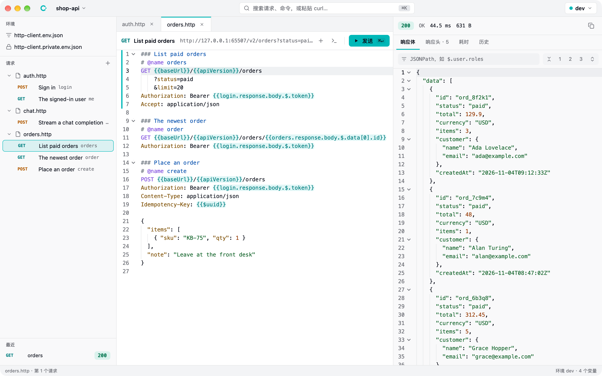
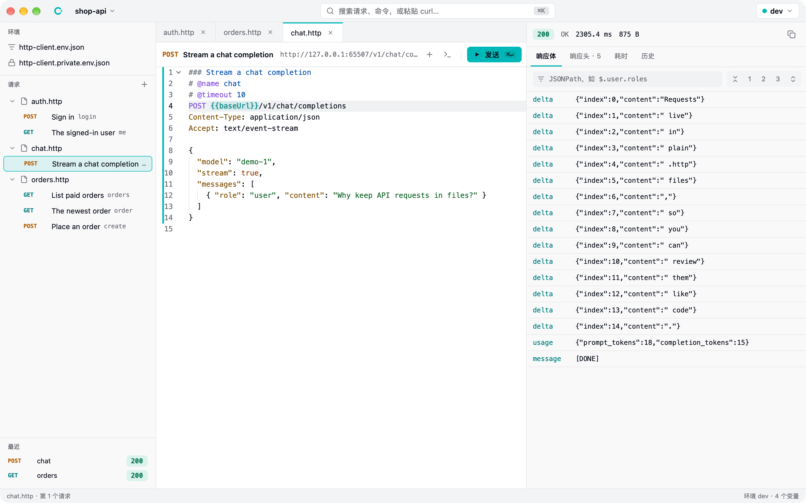
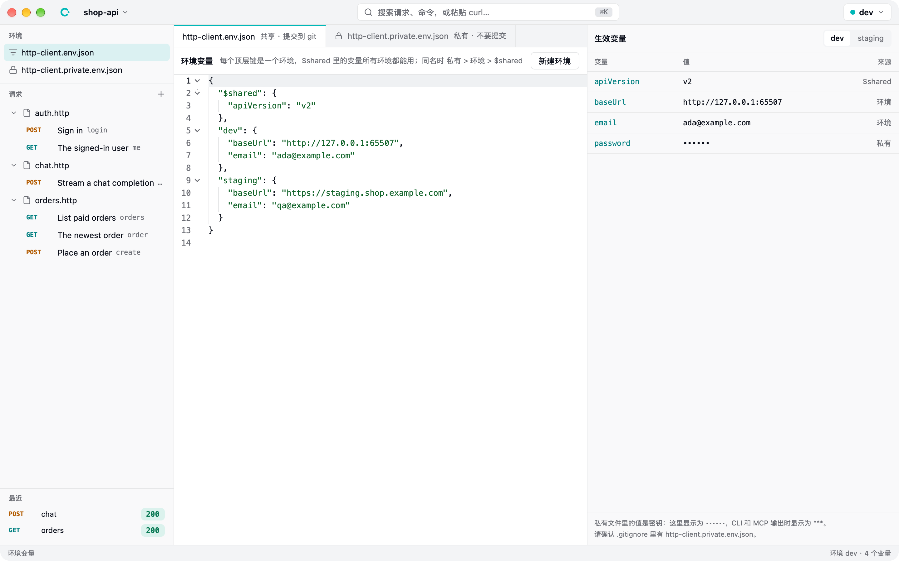
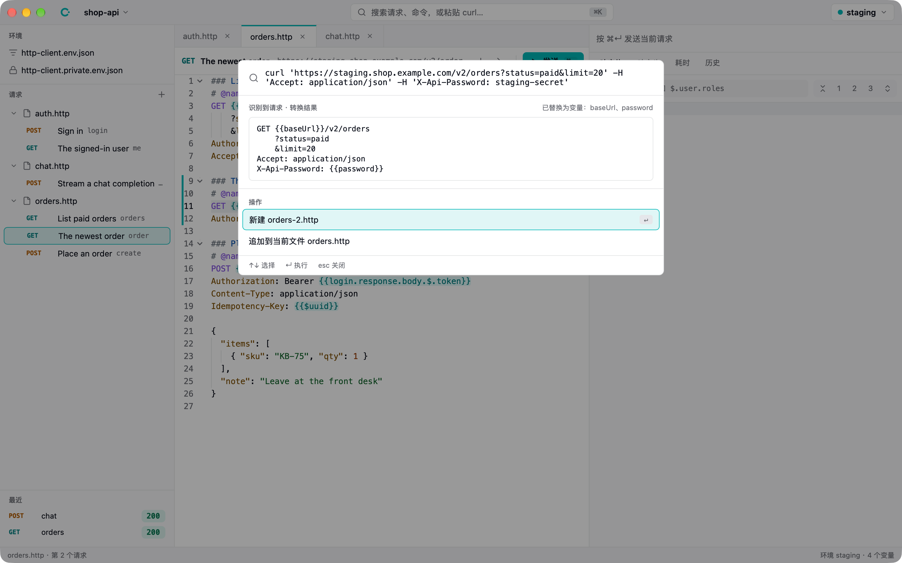
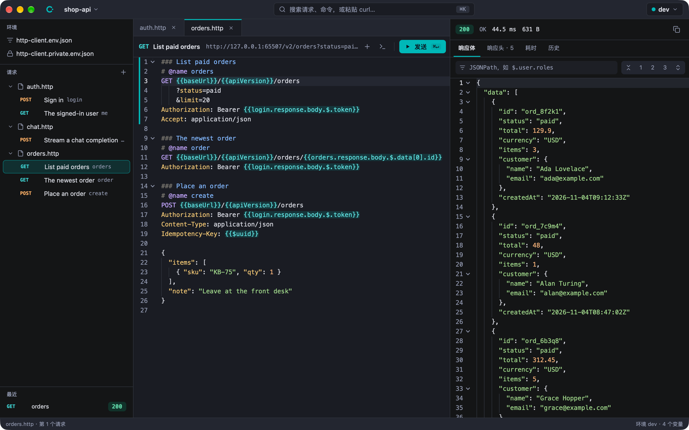

# callme

callme is a lightweight API client for people and AI agents alike, built with Native Shell. A request is a few lines of text in a `.http` file, the format the JetBrains HTTP Client and VS Code REST Client read, so requests sit next to the code, show up in diffs and go through review. There are no accounts, no cloud sync and no import or export.

## Write requests as text

The editor knows the format: highlighting, completion of headers, variables and request names, diagnostics for undefined variables and malformed JSON, Command-click to go to a definition, and folding by request. Hover a variable to see its value in every environment, with secrets masked. A request can use a value from another request's latest response, and callme runs that one first when it has to.

## Read responses quickly

JSON responses fold by their structure and filter by JSONPath. Server-sent events appear as they arrive. Every response records its headers, the time of each phase (DNS, connect, TLS, first byte, download) and a history of earlier runs.

## Environments and the palette

Environments are JSON files: shared values, one block per environment, and a private file for secrets that stays out of Git. The Command-K palette finds requests and commands, turns a pasted curl-style command into a request with its base URL and secrets replaced by variables, and any request can be copied back out as curl.

## Built for AI agents

The same core runs the desktop app, the command line and an MCP server. Agents edit `.http` files with their own tools, run them and get structured JSON back, and the app reloads files as they change.

[GitHub repository](https://github.com/lvwxx/callme)
