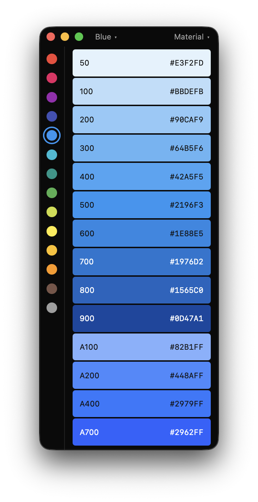

# Colors

A handy app for copying colors from your favourite palette. Click a swatch to copy its hex value, or right-click to copy it as rgb, hsl or oklch.

## Palettes

Material, Tailwind, Elementary, IBM, GitHub Primer, Radix, Atlassian and Nord.

## Background

A port of Material-Colors-native (React Native macOS) to Native Shell: one TSX app that runs natively on macOS, and from the same code on Windows, Linux, iOS, Android and the web. Heavily inspired by MaterialColorsApp.
