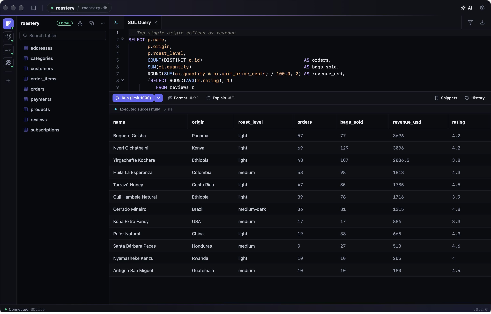
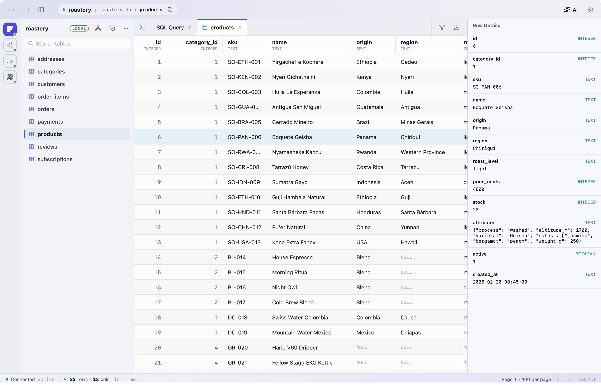
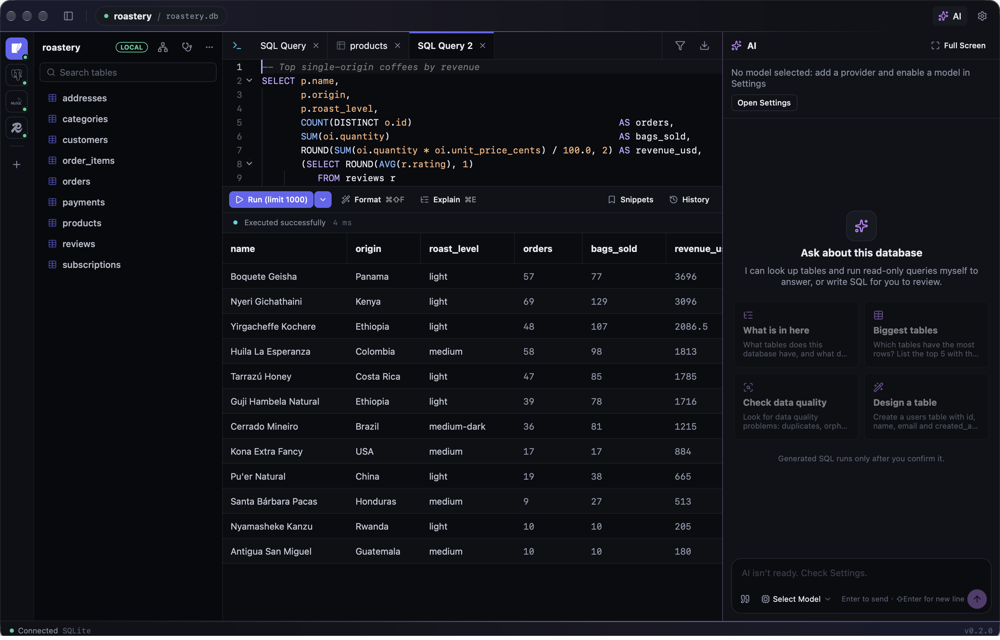

# Datum

Datum is a native database client for PostgreSQL, MySQL, SQLite and Redis, built with Native Shell. One window holds your connections, a SQL editor, table browsing and an AI assistant, and every risky operation is reviewed before it touches your data.

## Write and run SQL

The editor completes table and column names, suggests JOIN conditions from foreign keys and offers real values for low-cardinality columns. Run the statement under the cursor or a whole script, with one result tab per statement. Use named parameters, save frequently used snippets, format SQL, and see execution plans drawn as a tree with the slowest node highlighted. Results export to CSV, Excel, JSON, Markdown or INSERT statements.

## Browse and edit tables

Open any table to page through it, sort it, and filter the whole table on the server, including filters written in plain language. Edit cells and delete rows, then commit them together. The row detail panel shows every column with its type.

## Change data safely

Destructive statements are reviewed before they run, with a preview of how many rows they will touch, and production connections are stricter. UPDATE and DELETE statements, including multi-table and CTE forms, can be undone afterwards, from the result or from the query history.

## Look after your databases

The diagnostics view shows sessions, lock chains, long transactions, top SQL, unused indexes and table sizes for PostgreSQL, MySQL and SQLite, with actions such as cancelling a query or vacuuming a table after confirmation. Redis analysis finds the biggest and hottest keys, memory by prefix and the TTL distribution, across cluster nodes too. Schema compare lists the differences between two databases, covering tables, columns, indexes, foreign keys, views, triggers and comments, and writes a migration script with every drop commented out.

## AI assistant

Ask about a database in plain language. The assistant reads the schema and runs read-only queries itself to answer, explains errors and execution plans, and proposes SQL as cards you review before anything runs. It works with OpenAI-compatible, Anthropic and Gemini providers.

## Connect anywhere

Connect directly or through SSH tunnels with a password, a private key or ssh-agent, including jump hosts and host aliases from your SSH config. Passwords for staging and production are kept in the system keychain. The interface is available in English, Simplified Chinese and Traditional Chinese, with light and dark themes.

[Website](https://wenlingang.github.io/datum/) · [GitHub repository](https://github.com/wenlingang/datum)
