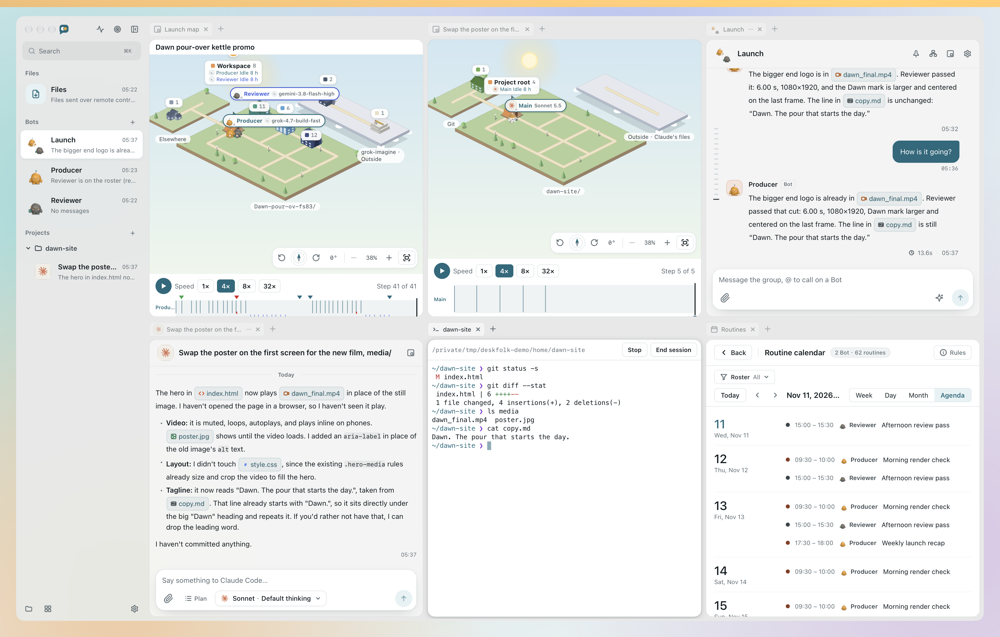
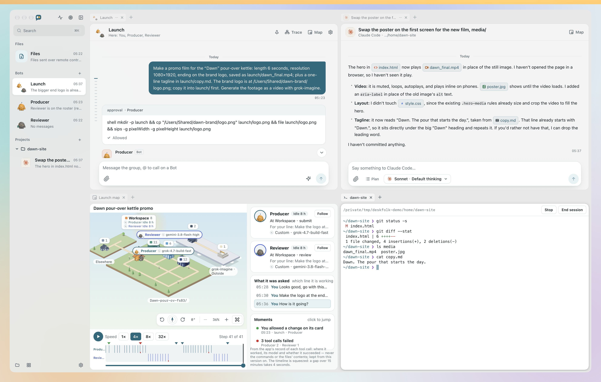
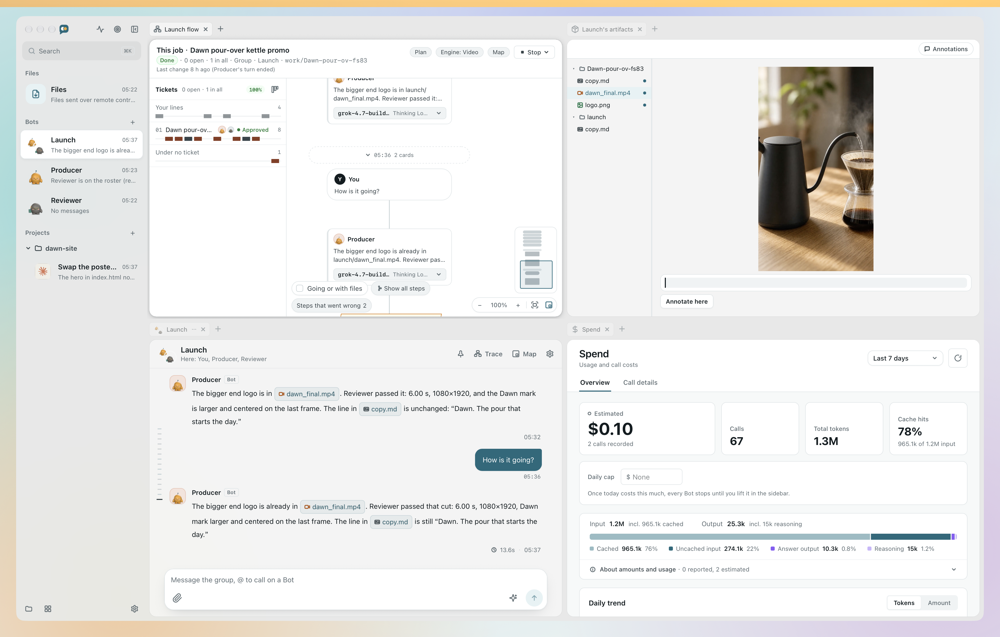
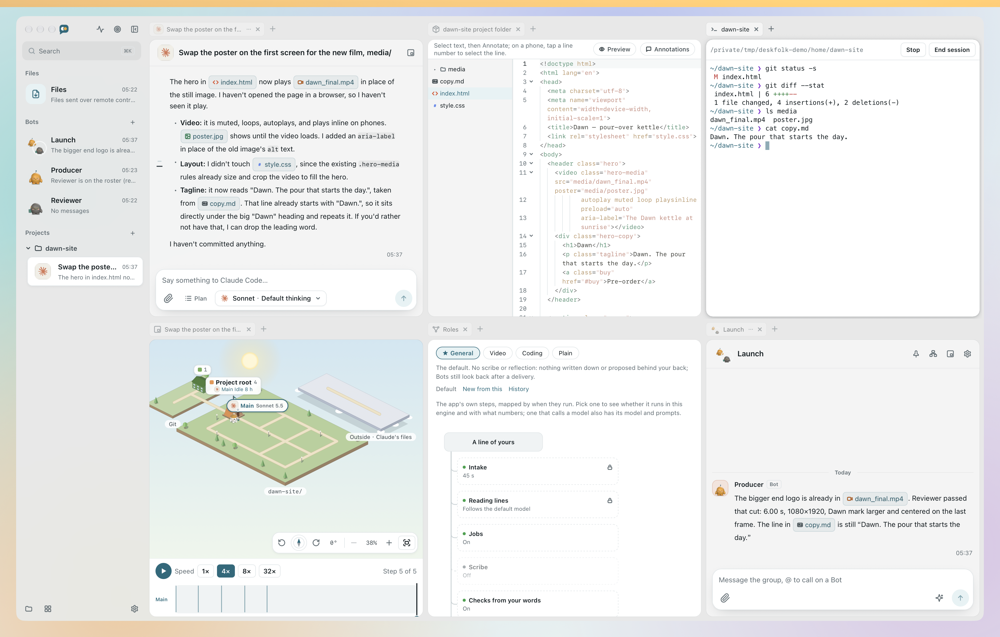

# Deskfolk

Deskfolk is a desktop app for handing work to a team of Bots and coming back to results. Bots have names, duties and boundaries; they chat one to one, join groups, get @mentioned and hand work to each other. Multi-day, multi-step jobs that need rework are safe to hand off too: when a Bot says done, the app checks first. The desktop app is built with Native Shell, on macOS and, as a preview, Windows.

## Runs on the agent you already use

No API key needed: pick the Claude Code, Codex, Grok, OpenCode, Antigravity or ZCode you are signed in to on this computer, or any ACP agent, and Bots run on your own sign-in. Or connect OpenAI, Anthropic, Xiaomi MiMo, Qwen, DeepSeek, OpenRouter or any OpenAI- or Anthropic-compatible endpoint, or Ollama, LM Studio and llama.cpp on your own machine. The work, the files and the keys stay on your computer.

## It asks as much as you want it to

A permission mode (read-only, ask first, auto or allow all) says what Bots may do without asking, and what waits on you is marked on the conversation list. Say stop and it stops: a stop is a record only you can lift, and your next line sets the work going again.

## It shows its work

A job is one tab: tickets on the left, each with who makes it and who reviews it; the flow in the middle, a card per turn marking the ticket it worked on, the files it handed over, the model it ran on and why. The task map plays the job back as a town of its folders, step by step, so you can see where each Bot worked.

## Done has a definition

A ticket moves only on a delivery, checks run on your computer, a review backed by evidence and your approval; a Bot writing "PASSED" moves nothing. Files are kept by job and ticket and open right in the app: images, audio and video, PDF, text and code, HTML and Office documents. Find fault right on the file, on a line, an image region or a moment of a video, and the Bot that handed it over works through your notes one by one. Spend is tracked by model, conversation and Bot, with an optional daily cap.

## Project sessions

Talk to Claude Code or Codex itself in a folder of yours, in the same window as your Bots: the project's files and the page it changed, a terminal, the session's task map, and the Roles that set how the app's own steps run.

## A workbench of your own

Split the window into panes of conversations, task maps, flows, terminals, the routine calendar, Spend and Usage. Bots can start work on a daily or weekly routine, and they get better with use: after a delivery, each Bot that tripped up reads the job's record and works what it learned into its own memories and skills. On macOS, pair a phone through a relay you run yourself, end-to-end encrypted, to follow and answer your conversations away from the desk.

[Website](https://blackman99.github.io/deskfolk/) · [GitHub repository](https://github.com/Blackman99/deskfolk)
