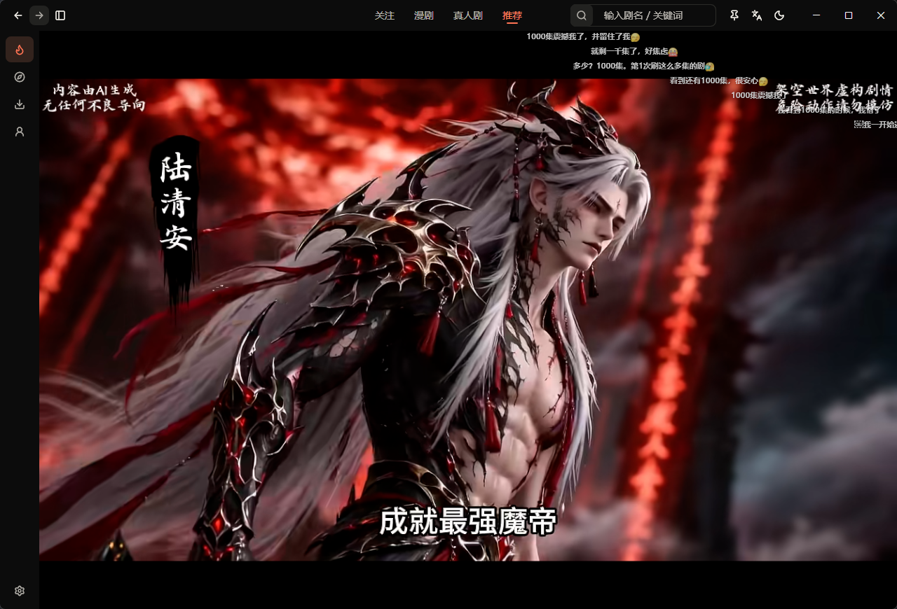

# guava

guava (番果) is an unofficial short-drama desktop client built with Native Shell (NSH) and a pure Rust application core for Windows and macOS, supporting light/dark themes and Chinese/English localization.

> Notice: For noncommercial learning and research only. This project is unaffiliated with any official service and does not store or distribute media content.

## Features

- **Immersive playback**: Browse Following, Animated, Live-Action, and Recommended channels, switch episodes smoothly, and resume from watch history.
- **Discovery and search**: Explore categories, rankings, and new releases with live search suggestions to open series details directly or run keyword searches.
- **Native player controls**: Switch episodes, playback speed, and video quality, with fullscreen, mini-player, portrait, always-on-top, and borderless window modes.
- **Danmaku and interaction**: Render live danmaku with emoji, read and reply to comments, and manage likes, favorites, follows, and reservations.
- **Local downloads and library**: Manage download queues, browse your personal library, merge series episodes losslessly, and clean up disk cache.
- **Desktop integration**: Includes system tray support, boss key, configurable global shortcuts, exit confirmation, and in-app update checks.

## Architecture and Highlights

- **Native UI and local decoding**: Built on NSH native views paired with system native audio clocks, dedicated hardware and software decoding adapters (including HEVC and ByteVC2 support), and GPU video enhancement for sharp, smooth playback.
- **Progressive prefetching and low overhead**: Uses budget-aware media prefetching that prioritizes active playback, driven by a unified Rust core handling state, persistence, and local media serving.

[GitHub repository](https://github.com/it00021hot/hongguo-desktop)
