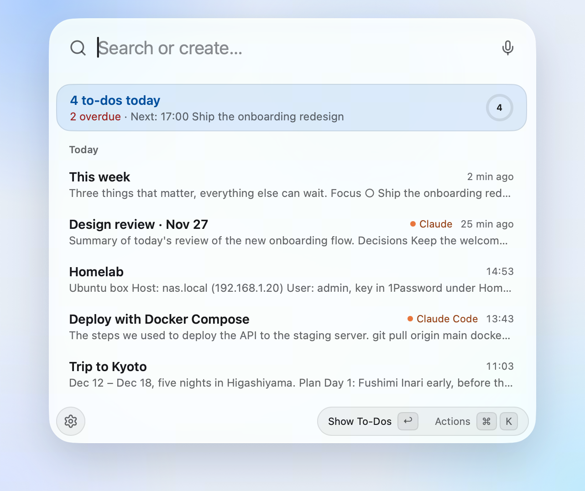
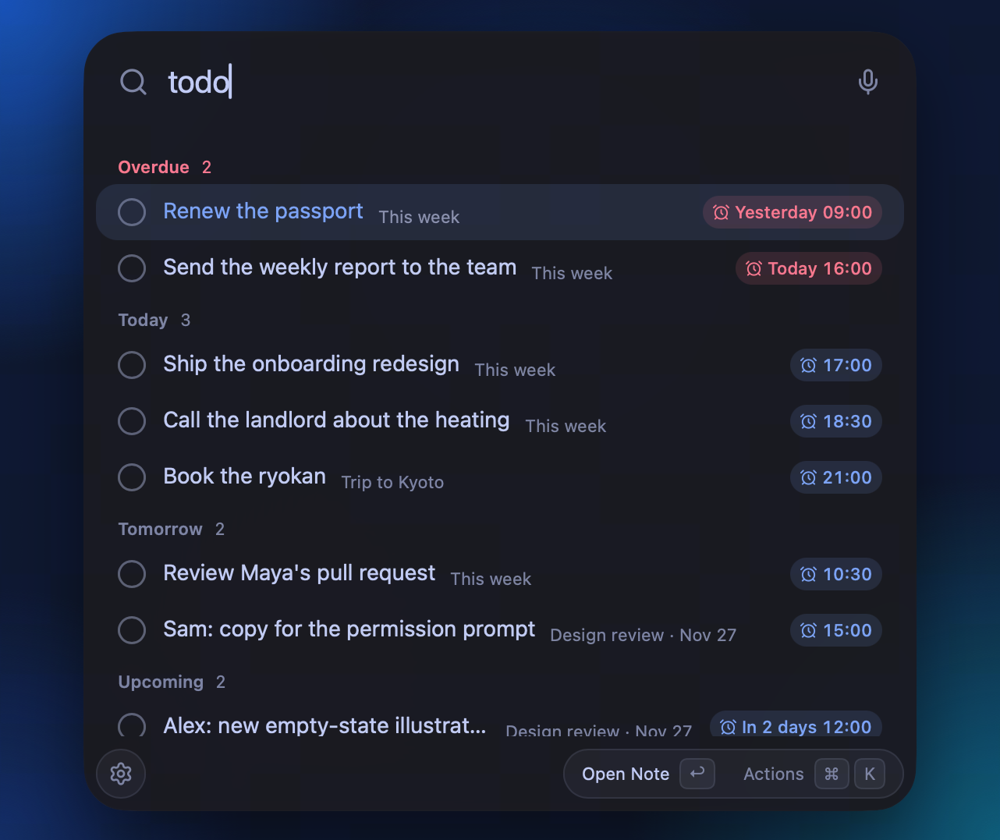

# Jot

Jot is a quick-notes notebook for macOS that you share with your AI apps. Double-press Option anywhere and a floating panel appears; press Esc and it is gone. Its interface is built with Native Shell in TSX, with the notes store, reminders and macOS code in Rust.

## Searching is creating

The panel has one field. Type, and it filters your notes by title and body as you type; when nothing matches, Return starts a new note with what you typed as its title. With nothing typed, today's to-dos sit above the notes you changed recently, grouped by day.

## Markdown, previewed live

Headings, bold, links, code and checkboxes render as you write, and their syntax shows only where the caret is, so there is no separate preview mode. Notes are saved as you type.

## To-dos in your notes

A task line in any note is a to-do, and writing a time makes it a reminder with a notification: "pay rent tomorrow 9am", in English, Chinese or Japanese. Typing "todo" lists every open to-do, grouped as overdue, today, tomorrow and upcoming, each with the note it is in. A time picker changes a reminder without typing.

## Shared with your AI apps

Jot carries an MCP server that works on the notes folder whether or not Jot is running. Settings connects Claude Code, Claude, Cursor, VS Code, Windsurf, Codex or Gemini CLI in one click. Then you ask them to note a command, remind you to send the weekly report on Friday, or tell you what is on your list today. A note an app writes carries its name, and a note you lock stays read-only for every app.

When an app writes on this Mac, an island opens out of the notch at the top of the screen: the app's name and the note's title in a glow of flowing colors while the note is written, then a check once it is saved. A click on it opens the note.

<video src="island.mp4" poster="island.png" controls muted loop playsinline></video>

## Plain files, yours

One Markdown file per note, in iCloud Drive or any folder you pick. No account, no server and no analytics. Notes from Apple Notes come in with one import. Light and dark, eight themes, and English, Simplified and Traditional Chinese and Japanese.
