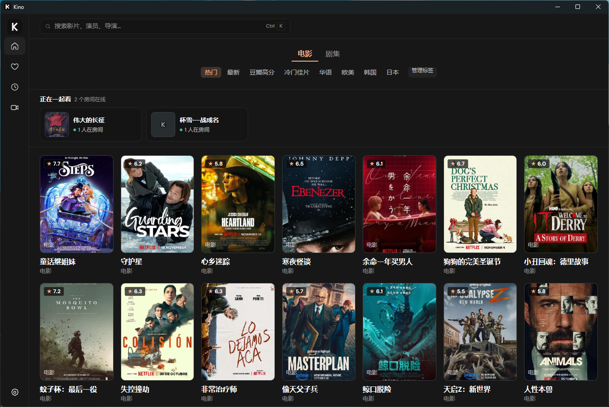
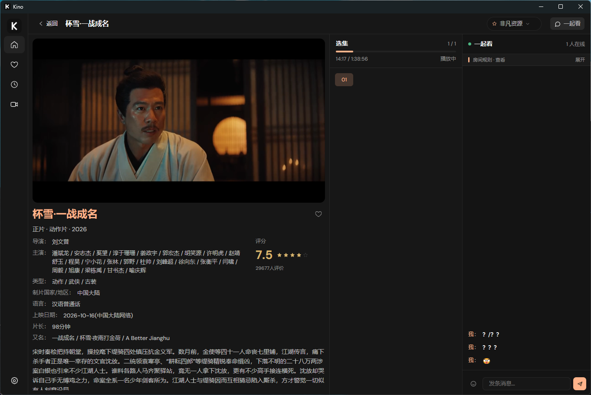
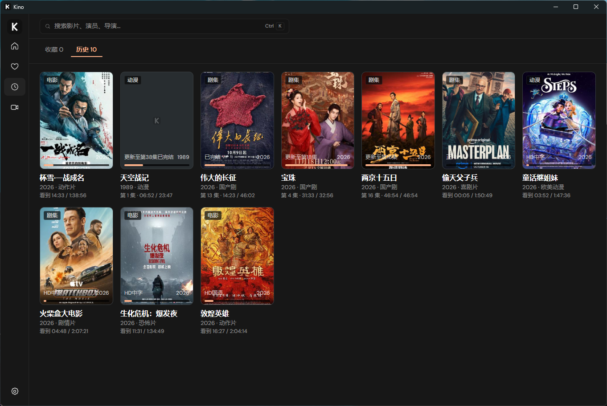

# Kino

Kino is a Windows desktop app for discovering films and series and watching them from sources you configure. The catalog, player, library, settings and chat are built with Native Shell components running on GPUI, so the interface is drawn natively by Rust instead of a web page.

## Discover

The home screen separates films and series with an underlined tab bar, then offers categories such as trending, latest, highly rated and regional picks. Cards show posters with ratings and loading placeholders appear while a page is fetched; the grid keeps loading as you scroll. A command-style search panel opens in the centre of the window with trending titles, recent searches and a clear action. Search results can be matched to an available source and opened directly.

## Watch

A title page lists every episode and keeps the current one highlighted while playback continues. Episodes can be switched without leaving the page, and the next episode starts automatically. Playback resumes from the exact episode and position recorded in the library. The video surface supports picture-in-picture and true fullscreen, hides the player's own loading logo in favour of the app's, and disables the context menu.

## Library

Favourites and watch history both use poster cards. Hovering a card reveals a delete control in its top-right corner. History cards carry a progress bar across the poster and record the episode, elapsed time and total duration, so a title can be continued later.

## Sources

Playback sources are editable entries rather than fixed links. Each source can be subscribed as a JSON configuration, imported, edited, enabled or disabled, and checked on demand; a source that fails its check is switched off automatically. When a title is available on several sources, the player can switch between them.

## Watch together

Every title has an anonymous chat room shared by all of its episodes. A generated nickname based on the visitor's city is used unless a custom nickname is set. Messages support emoji and mentions, with a visible mention reminder and a jump to the mentioned message. Room rules and global notices are shown in the panel. The relay only forwards messages to people currently online and stores no history.

## Native Shell

The interface uses Native Shell tabs, selects, inputs, sliders, toggles, sheets, toasts, command palette, emoji picker and chat components on the GPUI platform. The repository includes small platform-layer patches so embedded WebView content does not steal keyboard focus from native inputs.

[Kino on GitHub](https://github.com/diguo520/kino)
