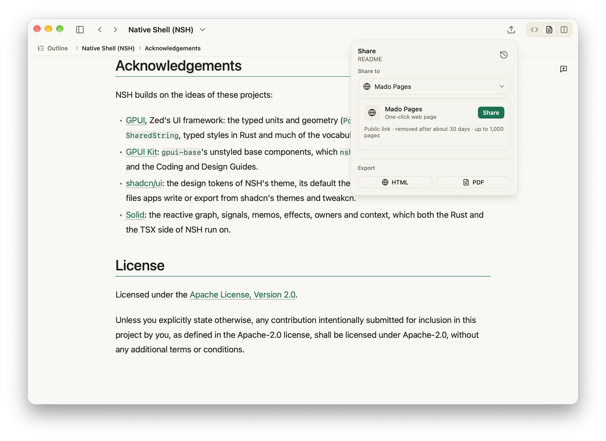

# Mado

**AI writes Markdown. Mado makes it readable.**

Mado is a native macOS app, built with Native Shell, for reading AI-generated Markdown: it opens a plan, spec, report or set of notes as a polished document, moves through folders of them, and shares a clean page when the work is ready.

## Reading first

Documents render with clear typography and spacing, syntax highlighting, images, tables, task lists and front matter. Lightweight Source and Split editing is there when a change is needed, while the default view stays focused on reading.

## Folders as workspaces

Open any folder as a Workspace and Mado presents it as a live file tree, with an outline, a table of contents, search, recent files and favorites. Opening a single Markdown file keeps the current Workspace as it is. Files stay plain Markdown on your disk.

## Ready to pass along

Export a document as HTML or PDF, or publish it as a clean link in one step. Connectors add export destinations of your own.

[Official website](https://madomd.com)
