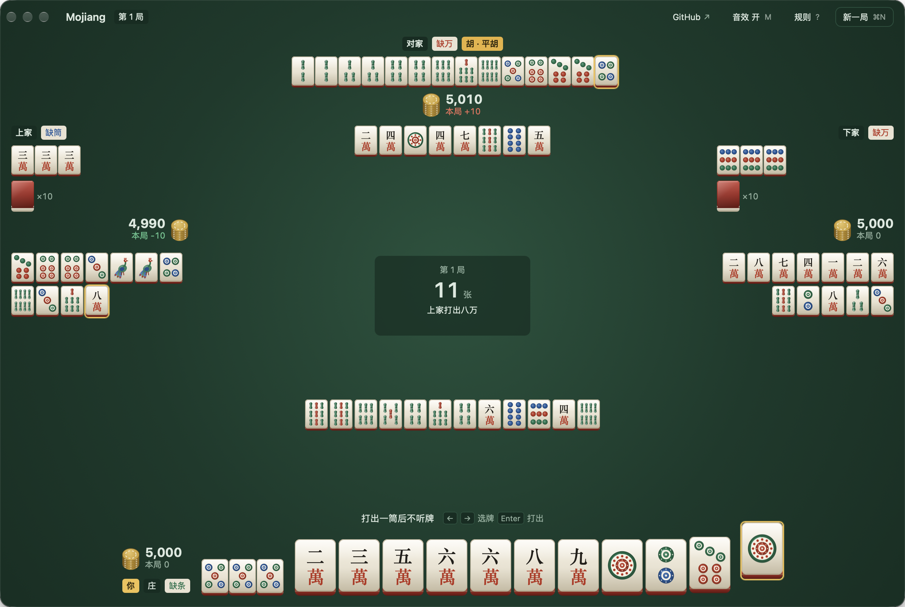
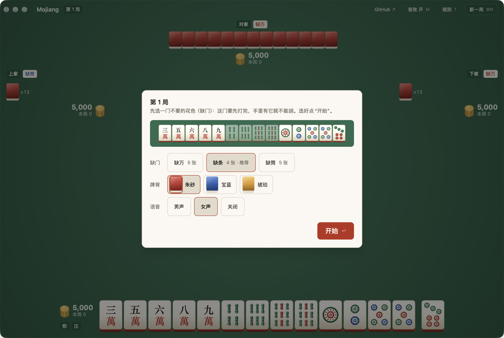
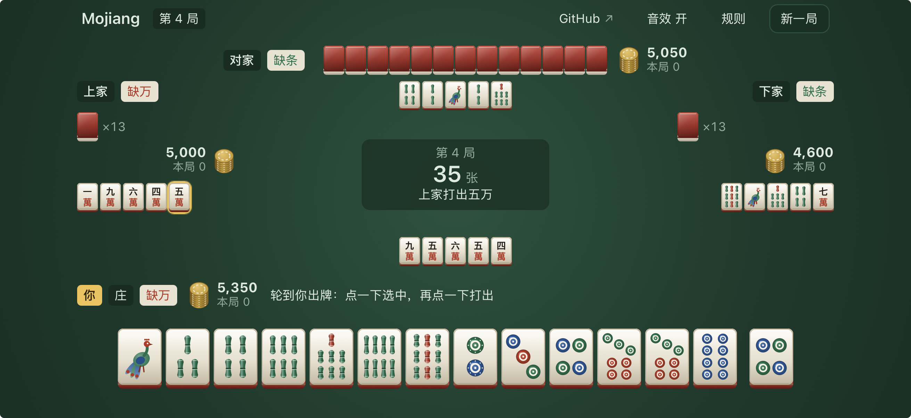
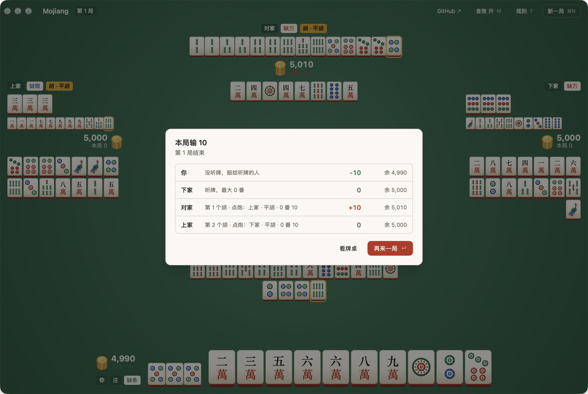

# Mojiang

A Sichuan Mahjong game in the Xue Zhan Dao Di (Blood Battle) style, built entirely in TSX with Native Shell. You play against three computer opponents on one table, on desktop, phone or the web. Its Chinese name is 血战到底.

## Rules

- 108 tiles: characters, bamboo and dots only; no chow, only pong and kong.
- At the start each player chooses a void suit and must discard it before winning.
- When a player wins they leave the table and the rest play on until one player remains or the wall runs out; one discard can win for several players.
- Points double per fan up to five fan. Concealed, added and exposed kongs pay out immediately (wind and rain).
- At a draw, players still holding their void suit pay everyone, and players not ready pay those who are.

## Playing

- Each player starts with 5,000 chips and the base stake is 10. A chip stack and the balance sit in front of every player and change as soon as money moves.
- A round opens with your hand, the void suit (the suggested one is preselected), the tile back and the voice, and a Start button.
- Your void-suit tiles always sit at the right end of the hand.
- Tap a tile to select it and tap again to discard, or use the arrow keys and Enter on desktop.
- Win, kong, pong and pass appear when a discard can be claimed, with H, G, P and Esc as shortcuts.
- The status line shows what you are waiting for after each discard.
- Each round's results show every player's hand, fan and payout.

## Design

- Every tile is drawn on a Canvas: an ivory face with a jade edge and a passing sheen, traditional characters, dots and bamboo, and a peacock for one of bamboo.
- Three tile backs to choose at the start of a round: cinnabar, sapphire and amber.
- Tiles lift, drop and land on springs; the hand ripples as the pointer moves across it; claims and wins pop in.
- Table sounds are synthesized: the shuffle, drawing a tile, the slap of a discard, the clack of pong and kong.
- Pong, kong, self-drawn win and win are called out in Sichuan dialect, with a male or a female voice for you; the computers have voices of their own.
- The felt fills the whole window, title bar included.
- Light and dark themes; phones play in landscape with a compact table that keeps all fourteen tiles in view.

Source: https://github.com/huacnlee/mahjong
