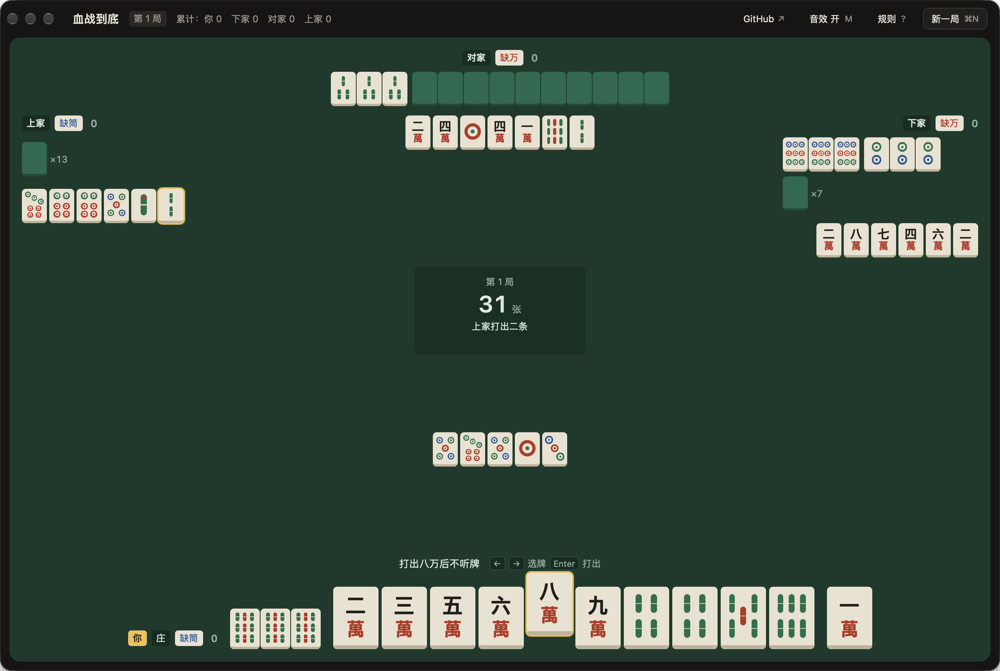

# 血战到底

A Sichuan Mahjong game in the Xue Zhan Dao Di (Blood Battle) style, built entirely in TSX with Native Shell. You play against three computer opponents on one table, on desktop, phone or the web.

## Rules

- 108 tiles: characters, bamboo and dots only; no chow, only pong and kong.
- At the start each player chooses a void suit and must discard it before winning.
- When a player wins they leave the table and the rest play on until one player remains or the wall runs out; one discard can win for several players.
- Points double per fan up to five fan. Concealed, added and exposed kongs pay out immediately (wind and rain).
- At a draw, players still holding their void suit pay everyone, and players not ready pay those who are.

## Playing

- Tap a tile to select it and tap again to discard, or use the arrow keys and Enter on desktop.
- Win, kong, pong and pass appear when a discard can be claimed, with H, G, P and Esc as shortcuts.
- The status line shows what you are waiting for after each discard.
- Each round's results show every player's hand, fan and payout; running totals are kept between rounds.

## Design

- Tiles are drawn with the traditional characters, dots and bamboo patterns, in light and dark themes.
- Tiles lift, drop and land on springs; claims and wins pop in; scores bump when they change.
- Short synthesized sounds for draws, discards, claims and wins, with a toggle.
- Phones play in landscape with a compact table that keeps all fourteen tiles in view.

Source: https://github.com/huacnlee/mojang
