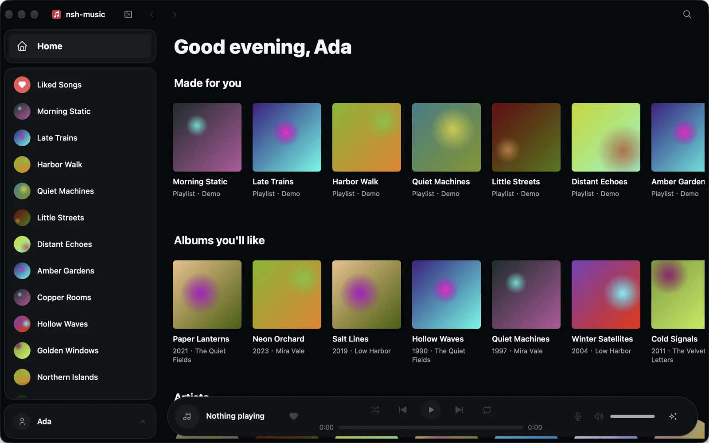
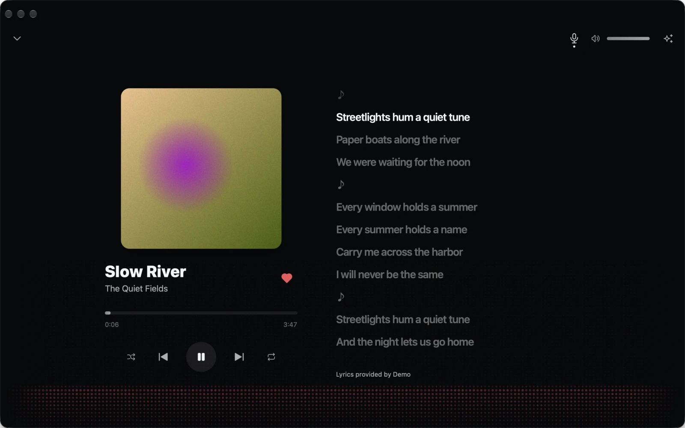

# nsh-music

nsh-music is a lightweight, native NetEase Cloud Music client built with Native Shell (NSH) in mixed Rust and TSX mode. It combines a native Rust networking and audio playback engine with a responsive cross-platform interface rendered through each operating system's own views.

## Key Features

- **Native Rust Audio Engine**: Decodes and streams audio natively with gapless progress seeking, volume control, shuffle, and repeat modes without bundling a browser runtime.
- **Real-Time Audio Visualizer**: Runs a 60fps FFT spectrum analyzer and beat detector directly on the decoded PCM stream, driving cover-art-reactive visuals without requesting system audio recording permissions.
- **Synced Lyrics and Now Playing View**: Displays line-by-line synchronized LRC lyrics with click-to-seek navigation and adaptive album-color ambience.
- **Complete Music Workflows**: Browse daily recommendations, curated playlists, and charts; search across tracks, artists, albums, and playlists; sign in via QR code to sync personal playlists and liked songs.
- **Desktop and Terminal Interfaces**: Ships with native desktop shells for macOS, Linux, and Windows, plus a keyboard-driven terminal (TUI) shell backed by the same Rust playback engine.
- **System Integration**: Supports system light and dark appearance switching, media key integration, and built-in background updates.

## Learn More

Explore the [nsh-music repository](https://github.com/Duskriver/nsh-music) for project details and source code.
