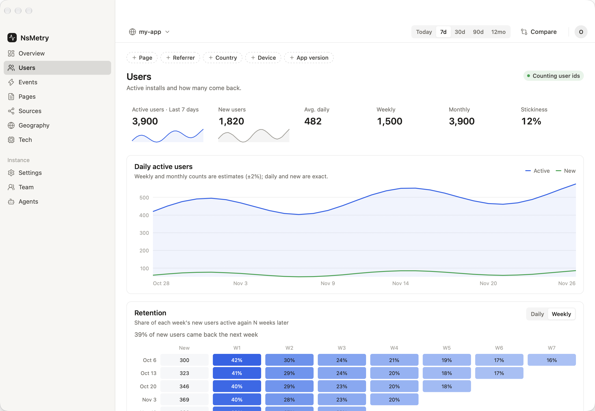
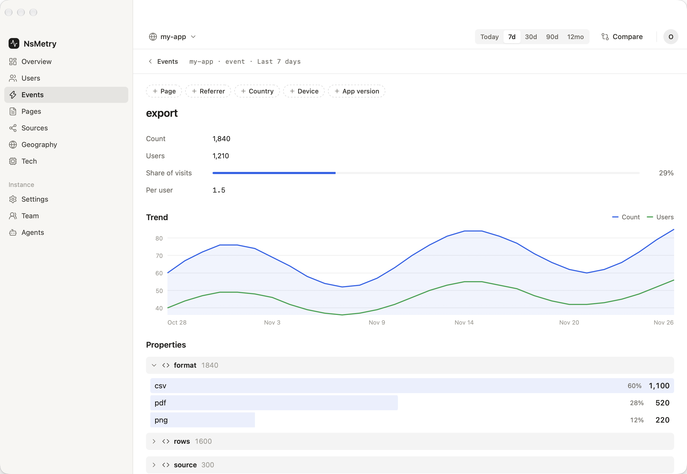
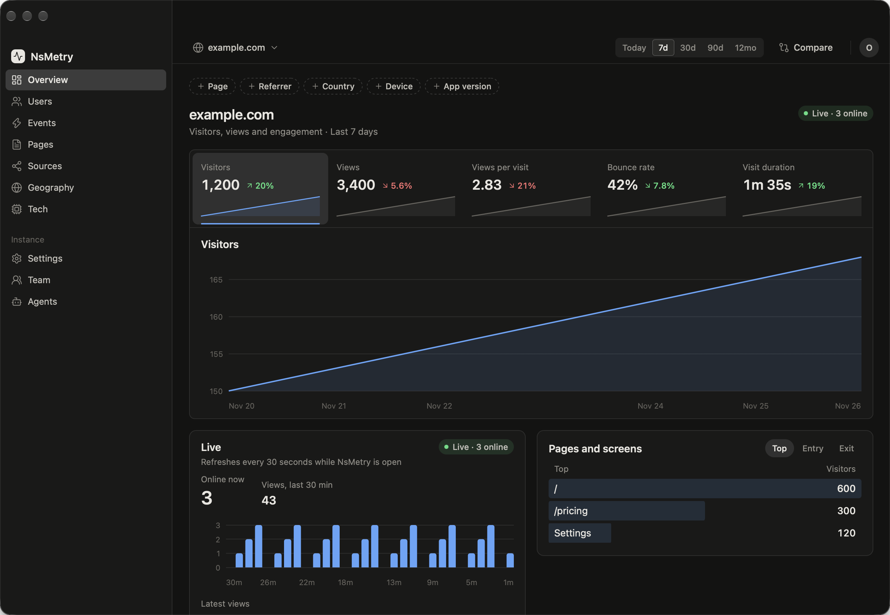

# NsMetry

NsMetry is analytics for your own apps and websites. It runs as one Worker and one D1 database in your Cloudflare account, on the free plan. You read the numbers in the NsMetry app, built with Native Shell for macOS, Windows, Linux, iOS, Android and the web, or ask your AI agent.

## App analytics

Daily, weekly and monthly active users, new users, stickiness and weekly or daily retention, counted from an anonymous install id that is hashed per site before it is stored. App versions and screens show which releases and views people actually use.

## Custom events

Every custom event has a count, users, its share of visits and a trend. Press an event to break it down by its properties, such as which export format people chose.

## Web analytics

Visitors, page views, views per visit, bounce rate and visit duration, compared with the previous period, plus a live panel. Breakdowns cover pages, entry and exit pages, referrers, UTM tags, countries, browsers, operating systems and devices. Press any row and every panel narrows to it, and filters stack.

## For teams and agents

Sign in with an emailed code, no passwords. The administrator invites viewers and picks which sites each one can read. Each instance is also an MCP server with OAuth, so Claude, Cursor or any MCP client reads exactly what the person who connected it can see.

## Private by design

No cookies and no consent banner. IP addresses are never stored, raw events are dropped within 48 hours, and history is kept as compact daily rollups for as long as you like.
