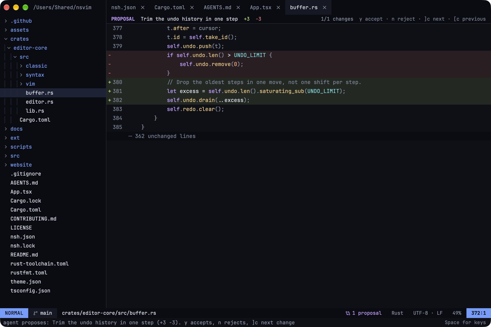
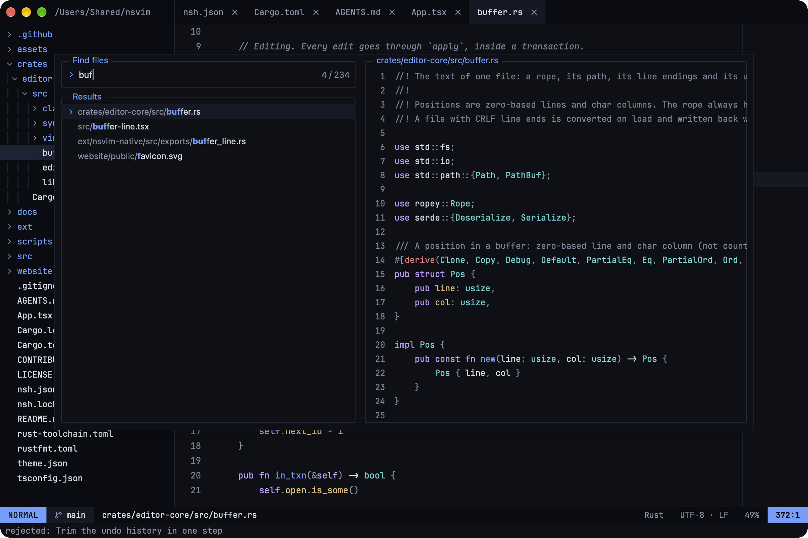
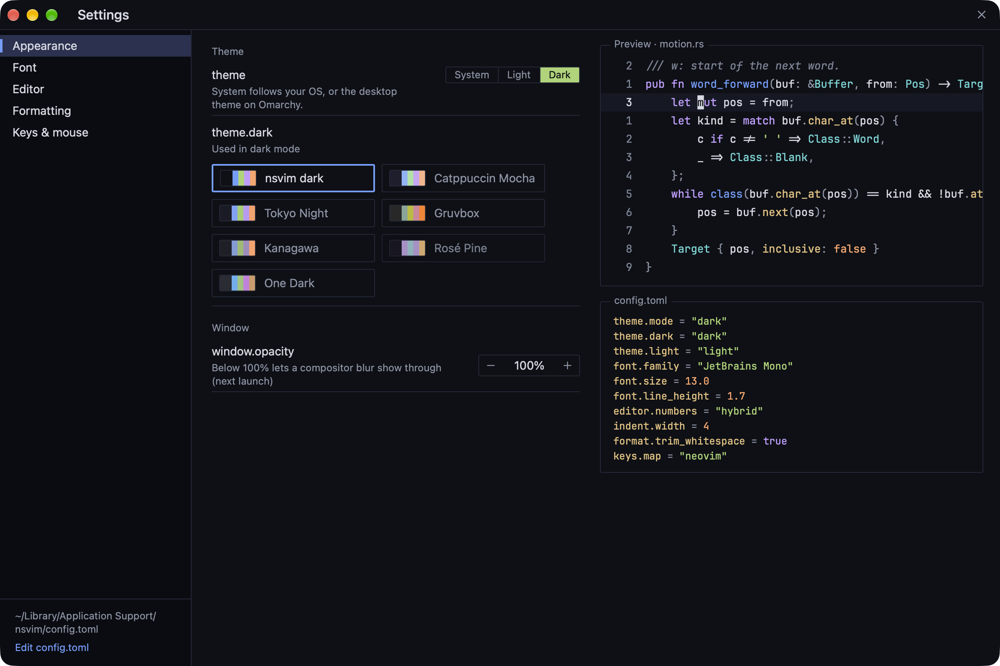

# nsvim

nsvim is a modal code editor for opening code, reading it, finding your way around it and making quick edits. It draws its interface with Native Shell, using GTK 4 on Linux, AppKit on macOS and WinUI on Windows.

## Vim, or classic keys

Counts, operators, text objects, dot repeat, registers, macros, marks and Visual block. Or no modes at all, with multiple cursors. You pick one at first launch and can switch any time.

## Code-aware

Tree-sitter text objects and motions work in 13 languages. LSP brings diagnostics, go to definition, references, hover, completion, rename and code actions from the servers you have installed.

## Works with your AI agent

There is no AI inside. Claude Code, Codex or any CLI agent sees what you look at and drives nsvim over its `mcp` or `ctl` command. An agent proposes a change as a diff, and you press `y` to accept it or `n` to reject it.

## Find anything

A fuzzy file finder with a preview, project search through ripgrep, a file tree with git status, and a searchable list of every key.

## Yours

16 themes, any monospace font, and a Settings view that shows a live preview and the `config.toml` it writes. On Omarchy, the System look follows the desktop theme live.

