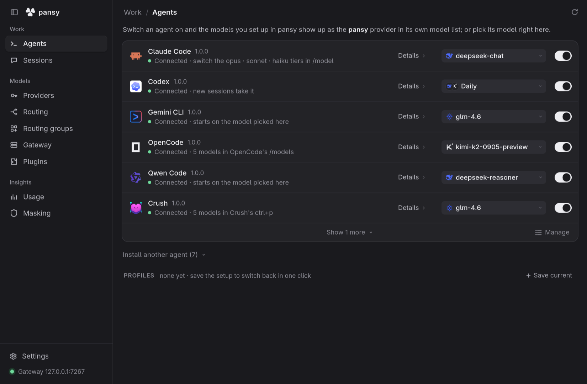

# pansy

pansy is a local gateway and a desktop app for Linux, macOS and Windows, written in Rust, its window built on Native Shell. Pick any model for any coding agent — Claude Code on Kimi, Codex on DeepSeek, Gemini CLI on GLM — and one gateway on your computer serves them all. Your keys, prompts and replies go only to the providers you chose.

## Any model, any agent

Claude Code, Codex, Gemini CLI, OpenCode, Qwen Code, Crush and some fifty other agents each take their model from one list. pansy edits the one setting that matters in the agent's own config, leaving comments, order and formatting as they were, and Disconnect puts back exactly what it changed. Before connecting, an agent's row shows every key it would set and what is there now.

## One gateway, four protocols

The gateway speaks Anthropic Messages, OpenAI Chat Completions, OpenAI Responses and Gemini, and translates between them, with streaming, tool calls and reasoning included. When an agent and a provider speak the same protocol, a request passes through untouched.

## Keys and subscriptions that fail over

A provider can hold several keys, tried in order. A key that is rate-limited, out of quota or refused rests for a while and the next one answers before the agent sees an error. Routing groups combine several models into one, in order, taking turns or least used first. ChatGPT, GitHub Copilot and Gemini Code Assist subscriptions serve every agent too, with what each has left of its allowance on the Usage page.

## Sessions, usage and masking

The Sessions page lists Claude Code's, Codex's and OpenCode's sessions by the folder they ran in, with what each spent and what was said, searchable by its words. Usage counts requests, tokens and cache reads by day, model, agent and provider, without keeping prompts or replies. Masking sends API keys, tokens, passwords and personal data out as placeholders and puts them back in the answer.

## Profiles and presets

Profiles save every agent's model under one name and switch them all back in one move. Sixty provider presets, from Anthropic, OpenAI and Gemini to DeepSeek, Kimi, GLM, Qwen, OpenRouter and Ollama, each come with their logo and coding plans or regions.

[Website](https://pansyai.dev) · [GitHub repository](https://github.com/pansy-ai/pansy)
