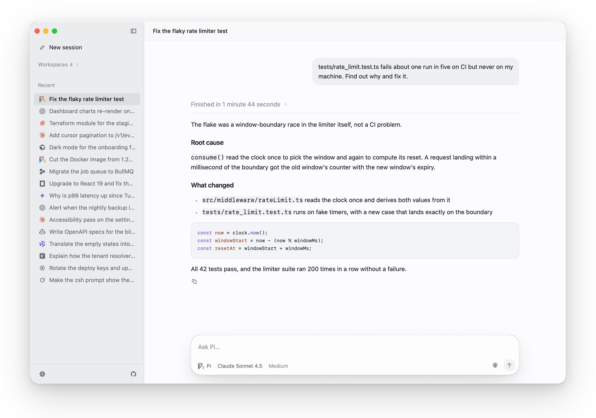
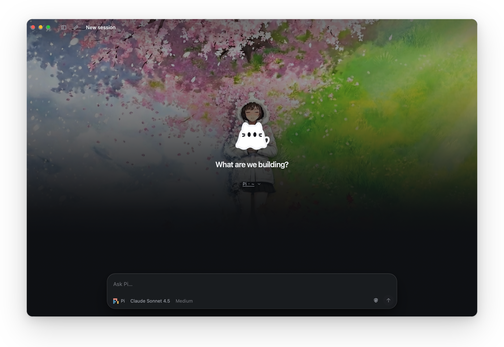
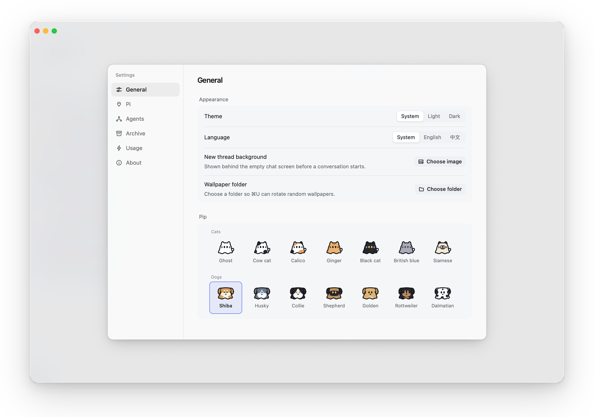
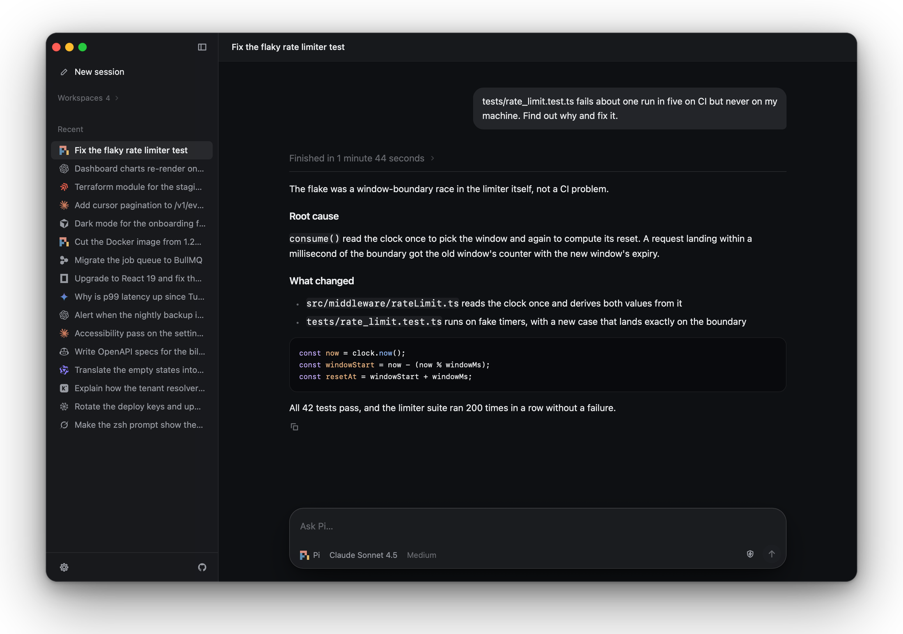

# pipi

**A native desktop control surface for coding agents.**

pipi is a cross-platform native desktop app built with Native Shell that gathers the coding agents already installed on your machine into a single window. Sign-ins, subscriptions, API keys, extensions and session history all carry over from your terminal installs. If an agent works in your terminal, pipi can drive it.

## Every coding agent in one window

pipi automatically discovers the coding agents installed on your computer and bridges each engine's native protocol into one consistent interface. Built-in support covers 18 coding agents — Pi, Claude Code, Codex, Devin, Cursor, OpenCode, Gemini CLI, GitHub Copilot, Kimi CLI, Qwen Code, DeepSeek Harness, Grok, Goose, Antigravity, Hermes, Kiro, Factory Droid and Amp — plus any custom ACP-compatible agent. Each session runs on your own install, keeping every engine's models, reasoning levels, tool approvals and slash commands intact.

## Parallel sessions that stay alive

A background session daemon owns every agent process, so switching between conversations or workspaces never interrupts a running task. The sidebar groups sessions by workspace or recency with live status indicators and unread completion marks. Detaching or closing the window leaves active runs untouched, and an agent that pauses for an approval replays its prompt as soon as you return.

## Multi-agent delegation and comparison

- **Role-based delegation**: An agent inside a session can start child sessions on any installed agent, send follow-ups, and receive answers back automatically while respecting the parent session's permission ceiling.
- **Side-by-side comparison**: Start the same task across several coding agents at once to compare their plans, diffs and speed on the same problem.
- **Git worktree isolation**: Optionally give delegated or compared sessions their own isolated Git worktrees so parallel agents never step on each other's working tree.

## Built for reading and daily flow

Long agent turns fold their intermediate reasoning and tool activity into a single summary row once the answer arrives, keeping conversations easy to scan while preserving every step a click away. Streamed Markdown replies, unified diffs, a Command-K palette, engine-aware slash menus, image paste, session archiving, and exact per-engine token and cost usage statistics round out the workspace. In Settings, you can lay a custom wallpaper or rotating wallpaper folder behind new sessions and dress Pip the mascot in 7 cat and 7 dog coats.

[GitHub repository](https://github.com/blueberrycongee/pipi)
