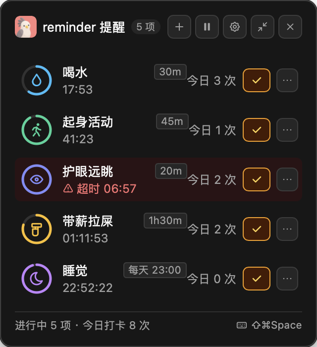
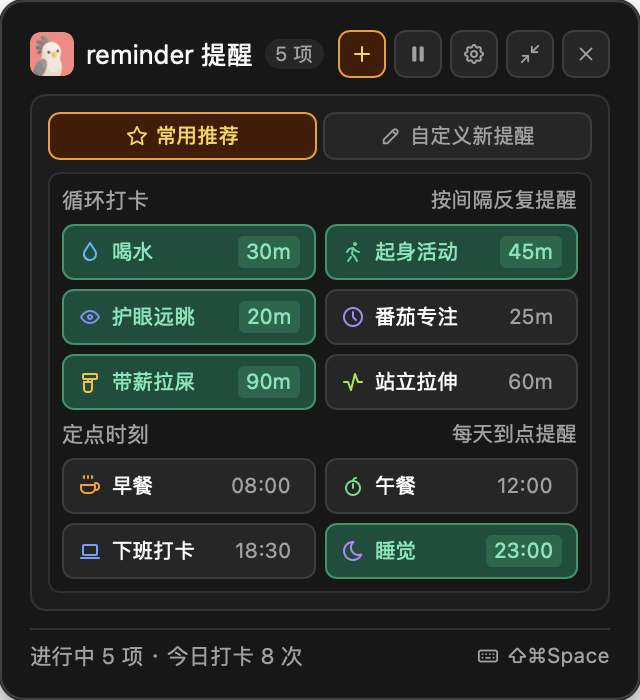
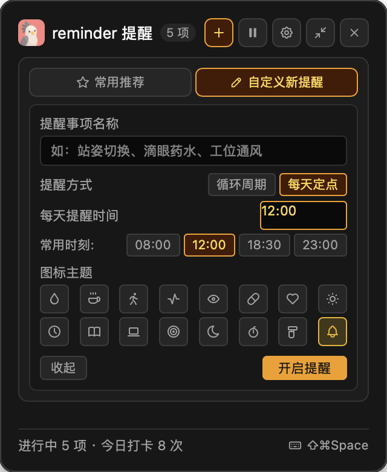
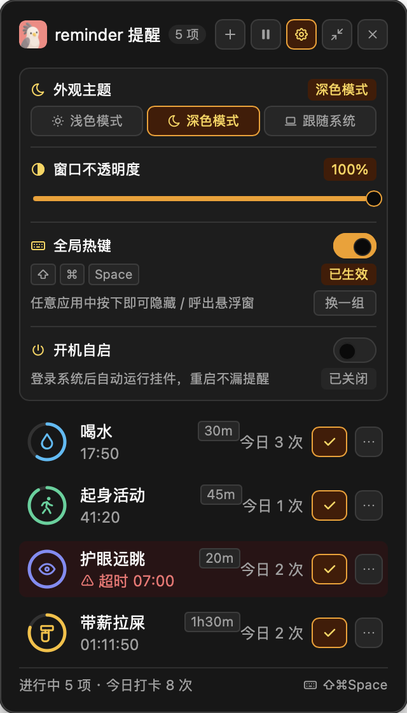

# Reminder

Reminder is a persistent desktop card built with Native Shell that reminds you to take care of everyday desk routines: drink water, stand up and stretch, rest your eyes, and keep healthy meal and sleep schedules. It stays cleanly on your screen, alerts you on time, and keeps running smoothly in the background or system tray.

## Two reminder modes

- **Interval timers**: Repeat every N minutes or hours (e.g. hydrate every 30 minutes, stand up every hour).
- **Daily fixed schedules**: Alert at specific clock times of the day (e.g. lunch at 12:00, bedtime at 23:00).

Check in with a single click to reset interval timers or mark daily goals as done. Postpone any reminder by 5 minutes from the row menu when busy.

## Built-in presets and custom reminders

Quickly enable popular templates such as water intake, stretching, eye relief, Pomodoro focus, and meal reminders, or configure custom items with personalized cycle intervals, notifications, and 16 icon themes.

## Desktop integration and mini capsule

- **Mini capsule**: Collapse the full card into a compact 196x44 capsule that hugs the screen edge while still showing the most urgent reminder and quick check-in actions.
- **Window management**: Always-on-top pin, free dragging with remembered position, adjustable opacity (20% to 100%), and system tray docking.
- **Audio and notifications**: Native system notifications and sound chimes ensure you never miss a routine.
- **Local-first**: Completely offline with local atomic file storage; no cloud account or internet connection required.

[GitHub repository](https://github.com/b-yp/reminder)
