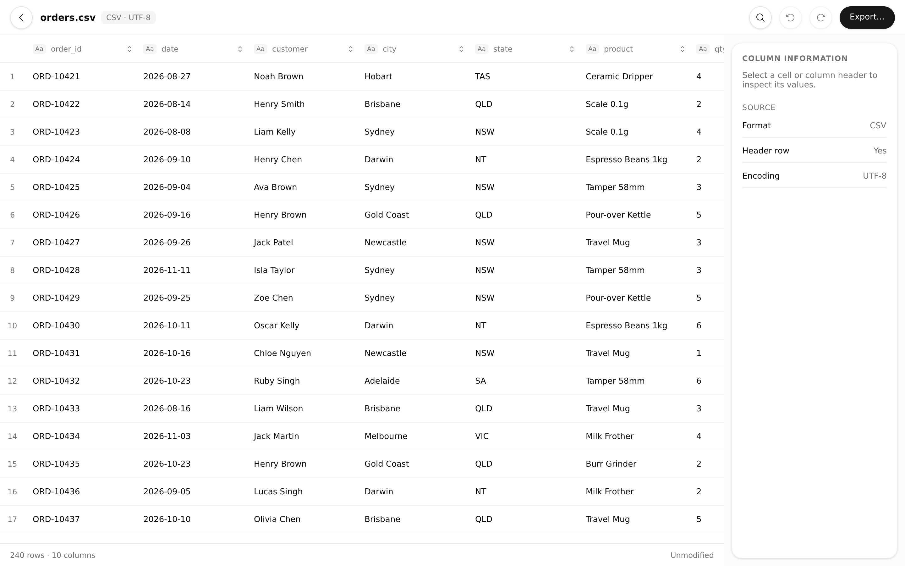
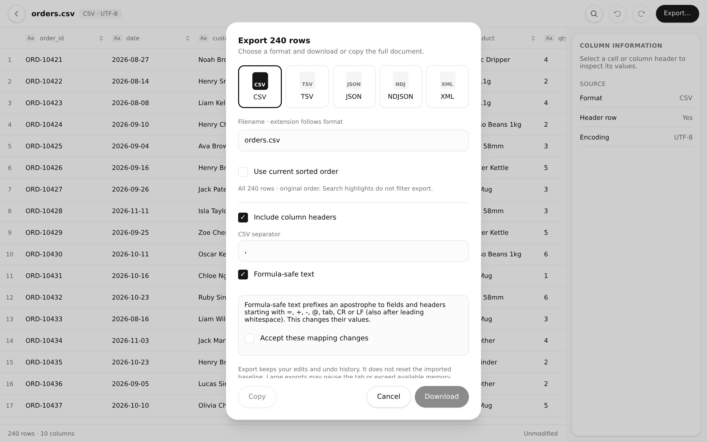
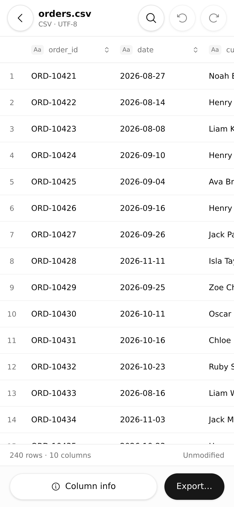

# Rowtation

Rowtation is a data viewer and converter that runs entirely in the browser, built with Native Shell. TSX draws the interface and Rust, compiled to WebAssembly, holds the document and does all the parsing, sorting, searching and exporting. Files never leave the device: there is no backend, upload or telemetry.

## Open your data

Drop a file onto the page, choose one from your computer, or paste text. Rowtation reads CSV, TSV, JSON, NDJSON and tabular XML. Before importing, you confirm the separator and whether the first row holds column headers. Every value stays as text, so leading zeros, `true`, `null` and formula-like values keep exactly what the file said.

## Inspect and edit

The document opens in a virtualized grid that loads only the rows on screen, so large files stay workable. Select a cell or column header to see exact column statistics in the inspector. Sort by any column, search within a scope, find and replace with literal text or regular expressions, and edit cells directly. Bounded undo and redo cover edits, and the status bar counts modified cells.

## Export

Export the whole document to CSV, TSV, JSON, NDJSON or XML, in the original or the current sorted order, then download it or copy it to the clipboard. CSV export can make text formula-safe for spreadsheets. Exporting never discards your edits or undo history.

## Desktop and mobile

On a wide window the inspector sits on the right and the toolbar on top. On a phone the same tools move to a bottom toolbar and the inspector opens as a panel, so both share one flow: open, inspect, export.

[Website](https://rowtation.pages.dev/) · [GitHub repository](https://github.com/crizant/rowtation)
