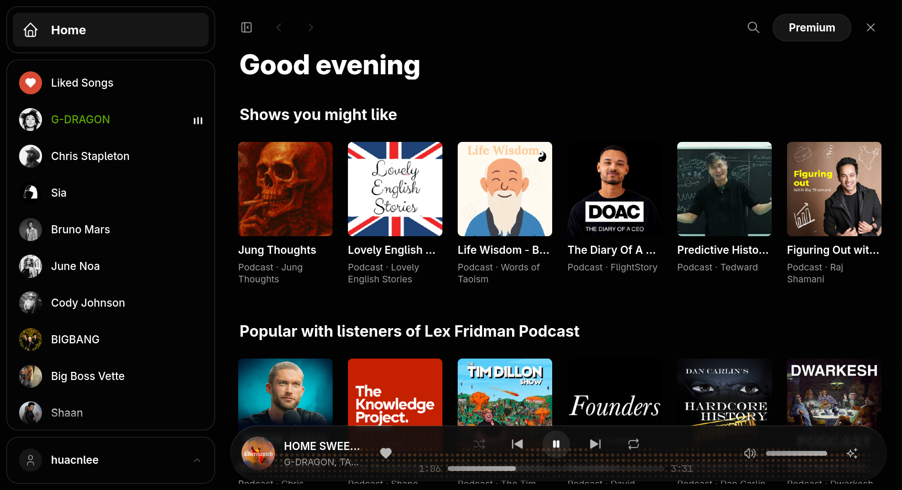
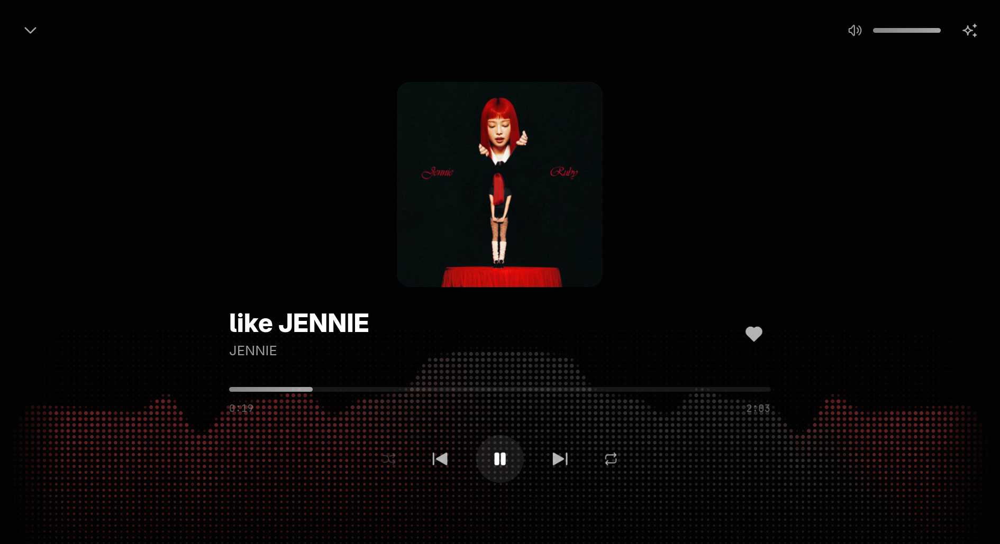
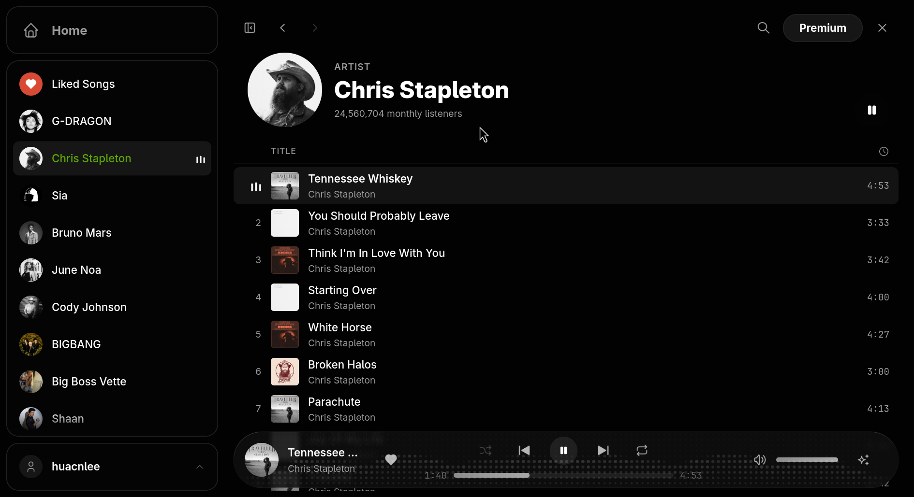
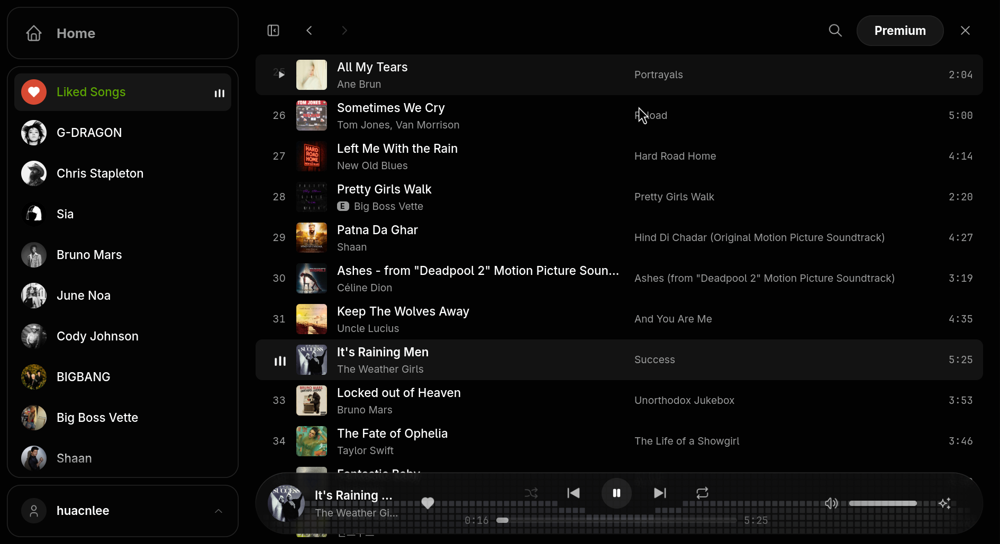
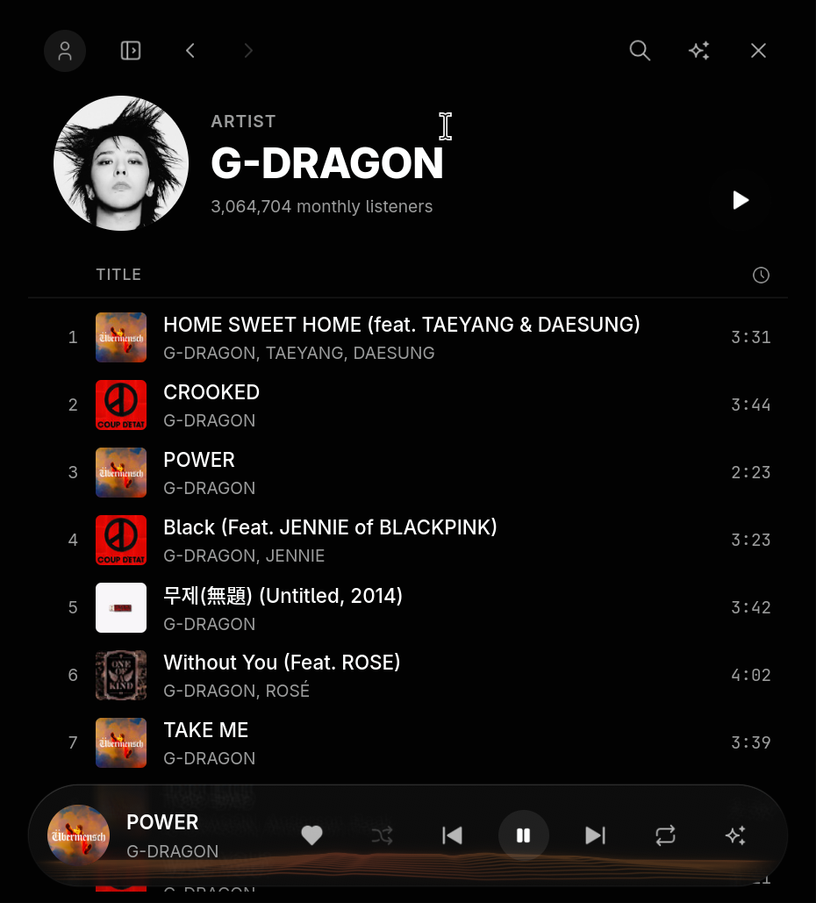
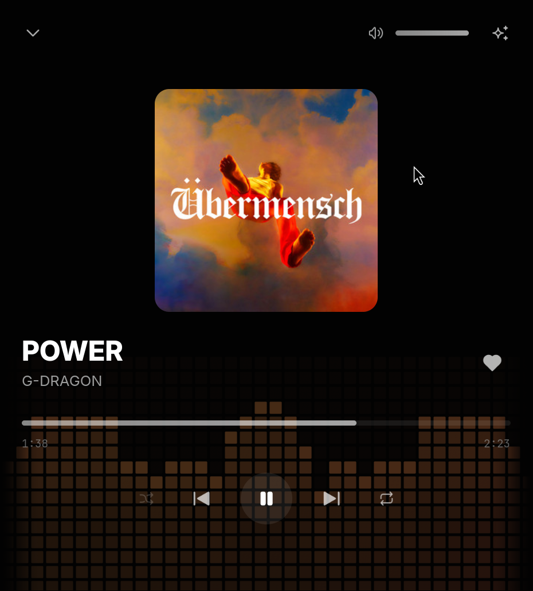

# Spotish

Spotish is an unofficial, native desktop client for Spotify, built with Native Shell to put NSH's animation and rendering through an extreme test on a real, non-trivial app. Spotify's web player is as sluggish as an Electron app; Spotish keeps that player out of sight and draws a fast native interface over it. It runs on macOS, Windows and Linux, follows the Omarchy theme live, and also runs in the terminal.

Your Spotify account, free or Premium, does the playing, so the catalogue, your library, Spotify's ads and Premium all work exactly as Spotify intends. Spotish never blocks, skips, mutes or shortens an ad. It is not affiliated with, endorsed by or sponsored by Spotify; Spotify is a trademark of Spotify AB.

## Features

- **Home, Search and Library**: the home page's rows of recommendations, search across the catalogue, and a sidebar with Liked Songs and the artists, playlists and albums you follow, marking what is playing.
- **Collection pages**: playlists, albums, artists and Liked Songs, with a header, a play button and every track in a virtualized, recycling list that keeps its scroll position in the navigation stack. Back and Forward work like a browser's, including Escape, Alt+Left and the mouse's back button.
- **Now Playing**: a full-screen sheet with the cover large, the full transport and a visualizer in the cover's colours. Its layout rearranges with the window: cover above, beside, or out of the way.
- **Adaptive layout**: a desktop layout with a sidebar, folding to a rail and then a single column with a mini player in narrow windows.
- **Desktop integration**: a tray icon with playback controls, hide-on-close so music keeps playing, media keys and the system's Now Playing (MPRIS on Linux, System Media Transport Controls on Windows, the Now Playing center on macOS), and automatic updates from GitHub releases.
- **Omarchy themes**: on Omarchy, Spotish reads the current theme's palette and switches with it live, mapping its colours onto the app's tokens with contrast checks so text always stays readable.
- **Terminal interface**: the same engine and the same pages drawn as a TUI, with the sidebar, the page and a two-row player.
- **Cached and instant**: every page shows what was cached for the signed-in account at once and refreshes behind it; controls show their result immediately and settle when the player confirms.

## How it works

Spotish is one Rust engine and one TSX interface, rendered through each platform's native views by NSH.

**The engine (Rust).** Widevine, the DRM that decodes Spotify's audio, comes only with a real desktop browser. So the engine finds an installed Chromium-family browser (Chrome, Chromium, Edge or Brave), starts it headless with a profile of Spotish's own, loads Spotify's web player and drives it over the Chrome DevTools Protocol. On macOS and Linux it talks through the browser's debugging pipe, so no port is opened at all; on Windows through a loopback WebSocket that web pages cannot reach. Signing in opens the same browser in a window. The engine copies an existing browser's Widevine component into its profile when it needs one, can import a login from an existing browser profile once (copying its cookie database consistently with SQLite's backup API), recovers when the browser exits, and exposes everything to TSX as a typed class: the player's state through listeners, data through async methods, and controls as methods.

**The bridge (JavaScript in the web player).** A script installed in the player's page before its own scripts run learns what the player itself uses to talk to Spotify, the headers of its GraphQL requests and the hashes of its persisted queries, so the app can ask for the same home page, searches, playlists, albums, artists and library. It reports the player's state, presses the player's own controls, and refuses seeking and skipping while an ad plays. Every page selector lives in this one file, it speaks a versioned protocol, and a newer bridge can ship in an over-the-air interface update and be swapped into the live page.

**The interface (TSX on NSH).** Pages, shells for desktop, phone and terminal, stores for the player, session and feedback, a cache-first data layer keyed by account, and a navigation stack. Images are decoded at the size they are shown, with a bounded memory budget, so long libraries stay light.

## Animation and the music's light

Almost everything that can move does, in several layers, all on NSH's native animation and GPU shaders, and all honoring the system's reduced-motion setting.

- **Live audio metering.** Widevine keeps the page from tapping its own audio, so on Linux the engine records Spotish's own browser stream from the system mixer (PulseAudio or PipeWire) and analyzes it with an FFT about 60 times a second: loudness, bass, mids, treble, a 16-band spectrum and a beat pulse, each normalized against the last few seconds so quiet and loud tracks move alike. The meter starts with its first visual and stops when none shows, while the window is hidden, or when the music is quiet.
- **Fourteen WGSL shader effects** light the player bar and Now Playing from the music: Spectrum, Bars, Wave, Ribbons, Aurora, Halo, Orb, Dots, Grid, Mountains, Mesh, Particles, Strings and Rhythm, chosen from the sparkle menu beside the volume. Each is painted in the cover's three colours, which travel along the light as the music plays, held to a brightness band that keeps the controls readable. The player bar is an opaque surface with the light in its own layer, so scrolling never costs a re-render of the page behind it.
- **The "playing here" mark** is three shader-drawn bars bouncing with the bass, mids and treble.
- **Pages and lists.** Sidebar choices cross-fade, Back and Forward slide through the stack, and a collection's header comes in line by line. Track rows wave in top to bottom each time a page is entered, sliding in while their covers flip open; rows scrolled to later come in on their own. These list motions animate only the channels they move, so a long list does not pay for unused native animation nodes.
- **Details.** Liking a song pops the heart and sprays a burst of red dots whose angle, reach, size and timing change every time; the search field grows out of its button; dialogs settle up from slightly smaller; new covers settle into place; and crossing a layout breakpoint glides the sidebar, player bar and Now Playing's cover to their new arrangement.

## Scale

The first version was built in about ten hours: some 6,500 lines of Rust for the engine and platform integrations, about 1,300 lines for the bridge, and nearly 10,000 lines of TSX for the interface, with more than 130 tests that run against recorded bridge payloads and demo data, with no Spotify account or network.

## Free and Premium

On Spotify Free, Spotish shuffle-plays playlists, albums and artists as Spotify's web player does, and ads play as Spotify serves them. Premium plays any track on demand without ads. Audio metering currently works on Linux; on macOS and Windows the visuals run at a resting level.

[Website](https://huacnlee.github.io/spotish) · [GitHub repository](https://github.com/huacnlee/spotish)
