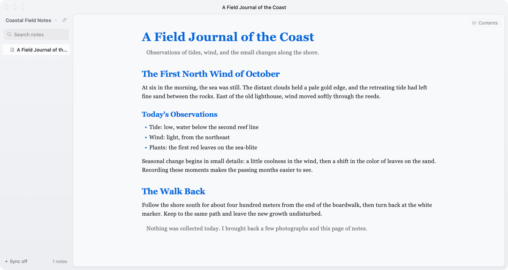

# StoatMD

**Note-taking built for the agent era.**

StoatMD is a native Markdown notebook for Mac and iPhone, built with Native Shell. On Mac it ships as a desktop app; on iPhone it is available through TestFlight as an internal beta. Your agent drafts straight into a local folder; you open the same folder to read, edit, and keep writing. Files stay plain `.md` on disk—no proprietary database, no StoatMD account.

## Reading and writing

Switch between clean full-width reading, raw Source, and Split preview. Typography and spacing stay calm so AI drafts and your own notes are easy to scan. Themes are curated for long sessions; the default keeps focus on the words.

## One folder, shared with agents

Local agents write Markdown into the folder through the filesystem. Remote agents sync through Google Drive or Dropbox. When edits collide, StoatMD pauses and lets you keep local, keep cloud, or keep both—nothing is overwritten silently.

## Sync without lock-in

Desktop includes Google Drive and Dropbox sync, free forever. There is no iCloud lock-in and no StoatMD-hosted sync server. Permissions stay with your cloud drive; a shared folder can double as a lightweight team knowledge base.

[Official website](https://stoatmd.com)
