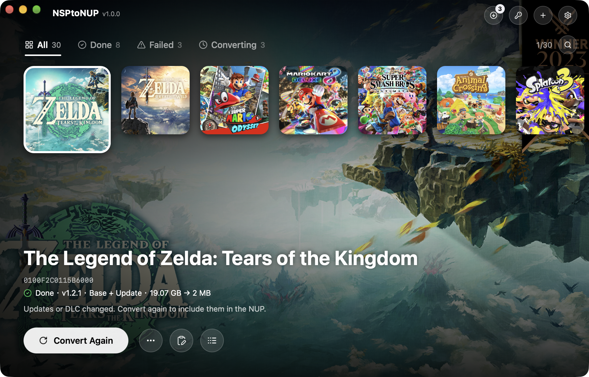
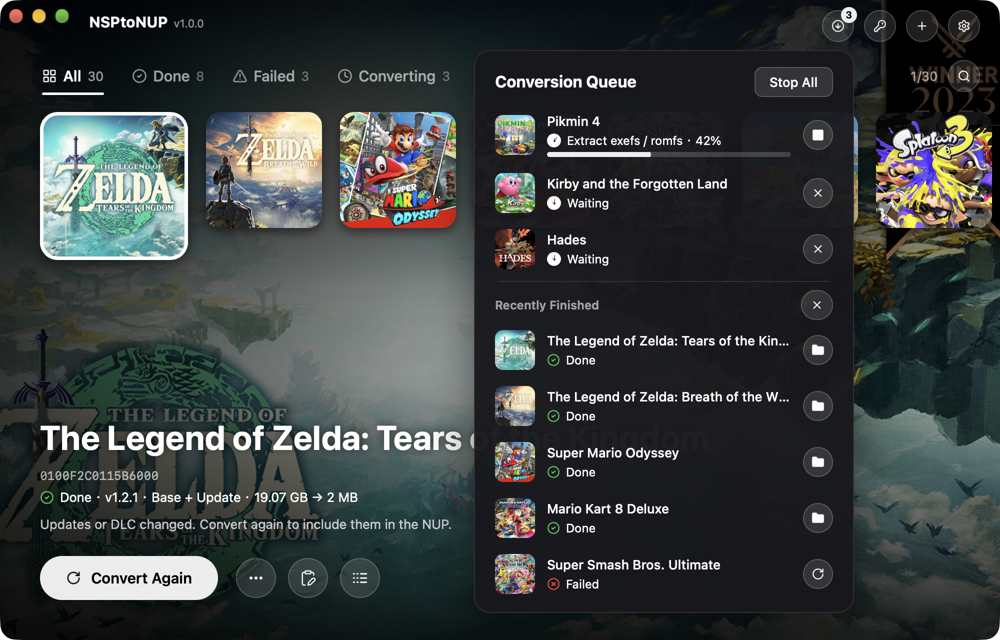
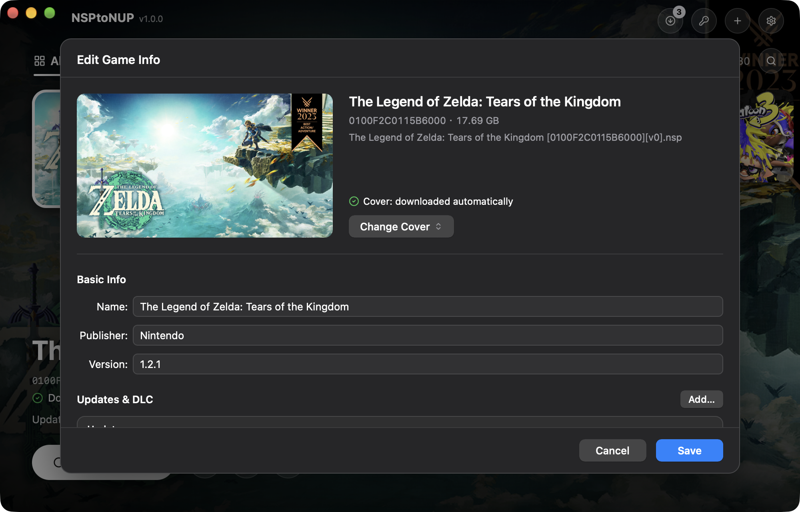
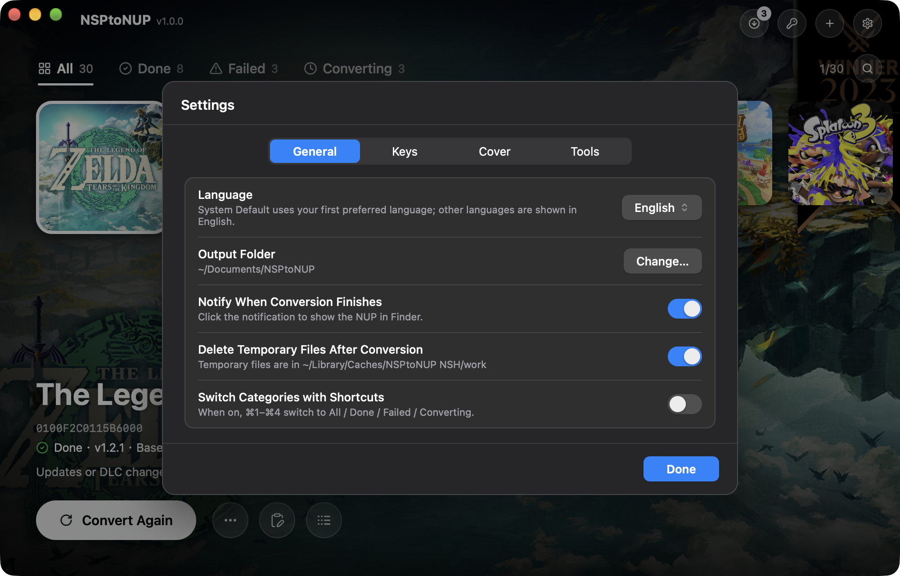

# NSPtoNUP

NSPtoNUP is a desktop app that converts Nintendo Switch NSP files into NUP, the unencrypted game
container format of the nup project. It is built with Native Shell and runs on macOS, Windows and
Linux.

## What it does

- **Converts NSP to NUP** one game at a time or a whole library in a queue.
- **Merges a base game with its update and DLC** into a single NUP package.
- **Identifies every file automatically.** Add NSP files or a whole folder and NSPtoNUP detects
  base games, updates and DLC and groups them by game.
- **Reads newer BKTR updates** directly from the NSP, without extracting them first.
- **Keeps a tidy library** with covers, game info and per-game conversion status.

## Workflow

1. Add NSP files or a folder.
2. Review each game, its update and its DLC, and edit the game info if needed.
3. Start the conversion and follow progress in the queue.
4. Open the finished NUP from the library.

## Lawful use

NSPtoNUP does not contain, distribute or download any firmware, keys or games. It is intended
solely for converting backups of games you legally own. It is an independent project and is not
affiliated with Nintendo.

Source code: [github.com/HereOrCode/Switch-Game-NSPtoNUP](https://github.com/HereOrCode/Switch-Game-NSPtoNUP)
