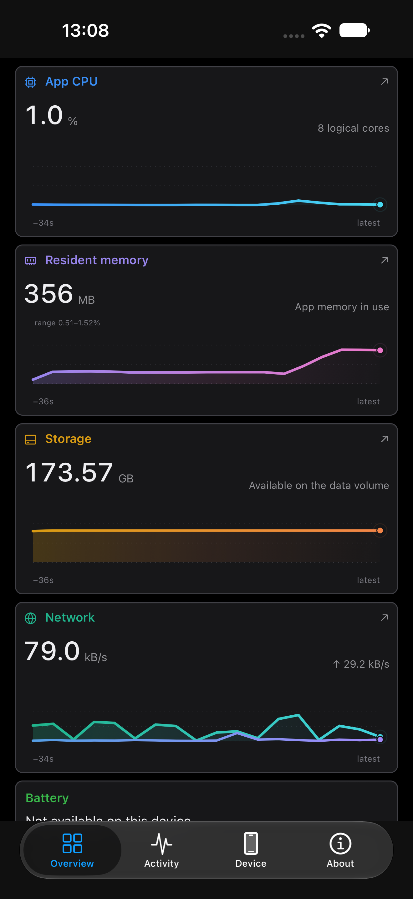
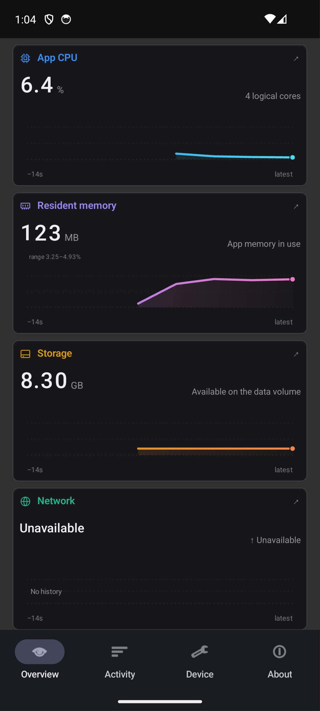

# sysmon

sysmon is a native system monitor for Windows, macOS, Linux, iOS and Android, built with Rust and Native Shell. It brings live resource readings, application activity and local developer workloads into one workspace.

## Live readings

CPU, GPU, memory, disk and network readings update every two seconds, as digit reels with stable decimal points and units. Charts plot the actual samples with gradient fills and live endpoints; hover, or press and drag, to read any sample. Network plots show download and upload in bytes per second, and pauses stay visible as gaps. The title bar keeps CPU, GPU, memory and disk activity in view on the desktop.

## Applications and workloads

Application lists aggregate processes, search live, and sort by CPU, memory or name, with expandable resource details. Developer projects and coding assistants are found from local processes, with their listening ports and how long they have run, and Docker containers are grouped by Compose project.

## Native motion

Transitions, springs, card entrances, reading updates and chart geometry run through NSH's native animation bindings, and reduced-motion settings are respected. Data stays on the device.

[GitHub repository](https://github.com/huacnlee/sysmon)
