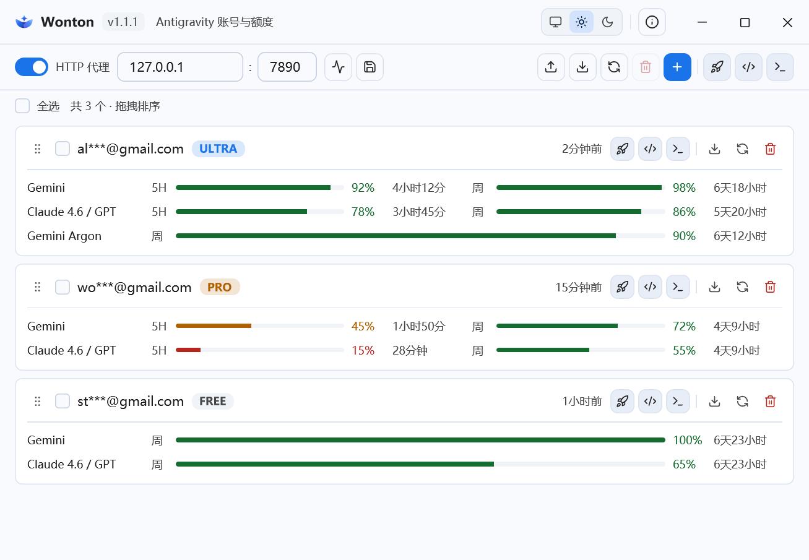
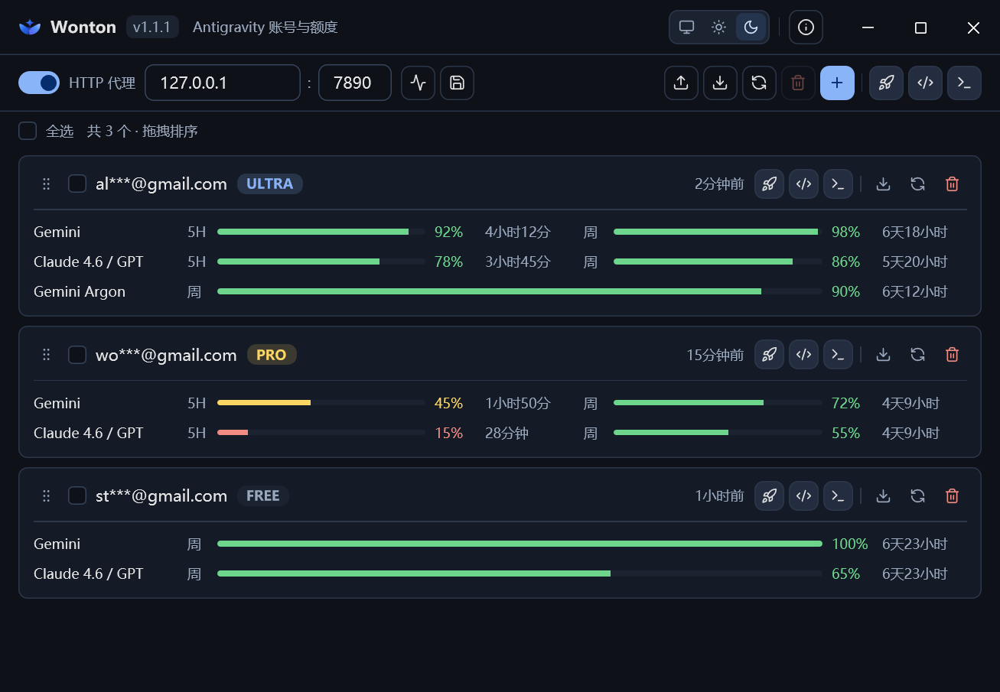
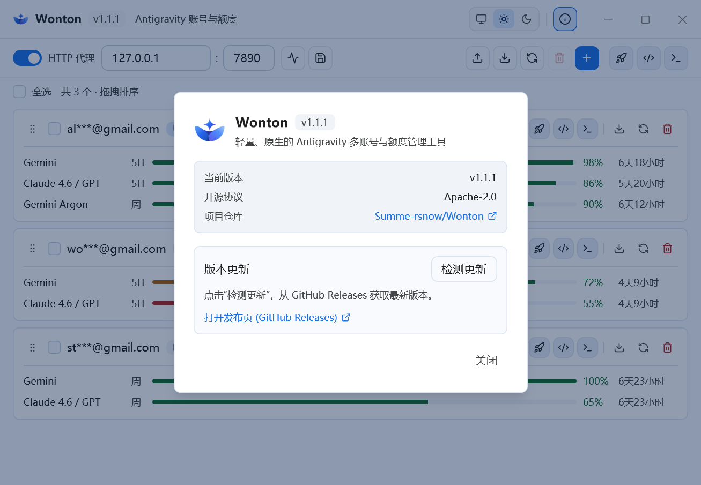

# Wonton

Wonton is a lightweight native Windows desktop application built with Rust and Native Shell for managing multiple Antigravity accounts, monitoring model quotas in real time, switching account credentials, and launching client processes through an isolated HTTP proxy.

## Real-time quota monitoring

Each account card displays subscription tier badges (`ULTRA`, `PRO`, `FREE`) alongside 5-hour (`5H`) and weekly quota bars for model pools including `Gemini`, `Claude 4.6 / GPT`, and `Gemini Argon`. Threshold color indicators and reset countdowns make remaining capacity easy to scan at a glance. Cards support drag-and-drop reordering with persistent ordering, as well as System, Light, and Dark appearance modes.

## Flexible account import and export

Accounts can be added and organized through multiple workflows:

- **Browser OAuth**: Complete Google OAuth sign-in in your browser and receive callbacks on a local loopback port with immediate quota refresh.
- **Manual token input**: Paste one or more refresh tokens as plain text or a JSON array.
- **Local client import**: Read refresh tokens directly from the local Antigravity client database (`state.vscdb`) on Windows.
- **Batch JSON import and export**: Import multi-account JSON bundles with concurrent token validation and live progress, or export individual, selected, or all accounts.

Sensitive tokens and proxy settings are encrypted locally using keys derived via HKDF-SHA256 and AES-256-GCM before being written to local application storage.

## Per-process HTTP proxy and client launching

Configure an HTTP proxy toggle with persistent host and port settings, and test proxy connectivity and latency with one click. From the toolbar or individual account rows, Wonton can switch credentials and launch Antigravity Classic, Antigravity IDE, or Antigravity CLI (`agy`) directly. Proxy settings apply only to launched child process trees without modifying system-wide proxy settings or installing virtual network adapters.

## Native desktop workflow

Wonton includes system tray integration on Windows with quick actions to show the window, refresh all accounts, check for updates, or configure close-to-tray behavior. An in-app About dialog surfaces version details and checks GitHub Releases for newer versions.

[GitHub repository](https://github.com/Summe-rsnow/Wonton)
