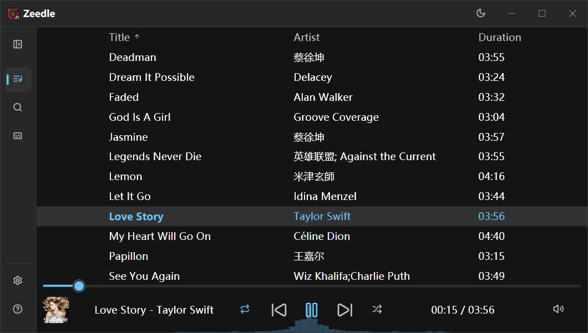
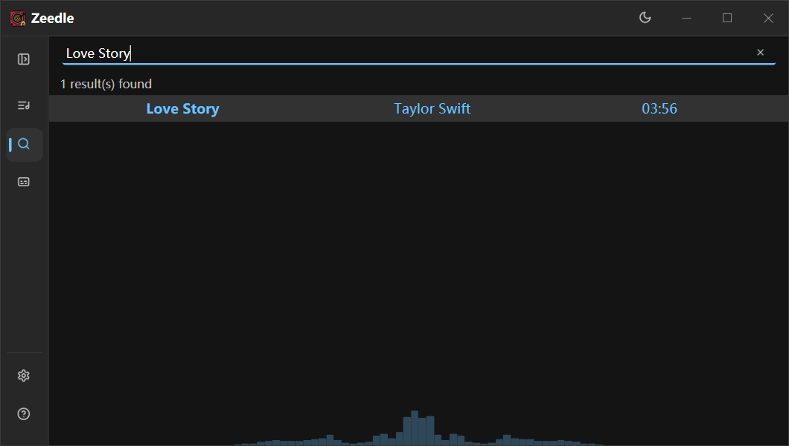
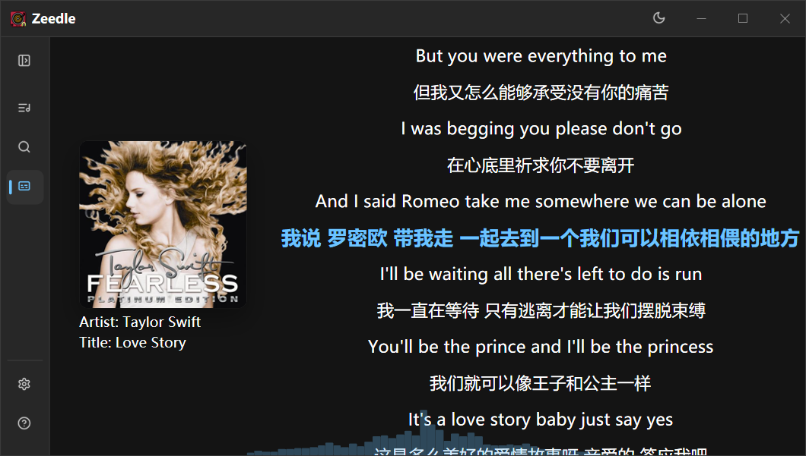
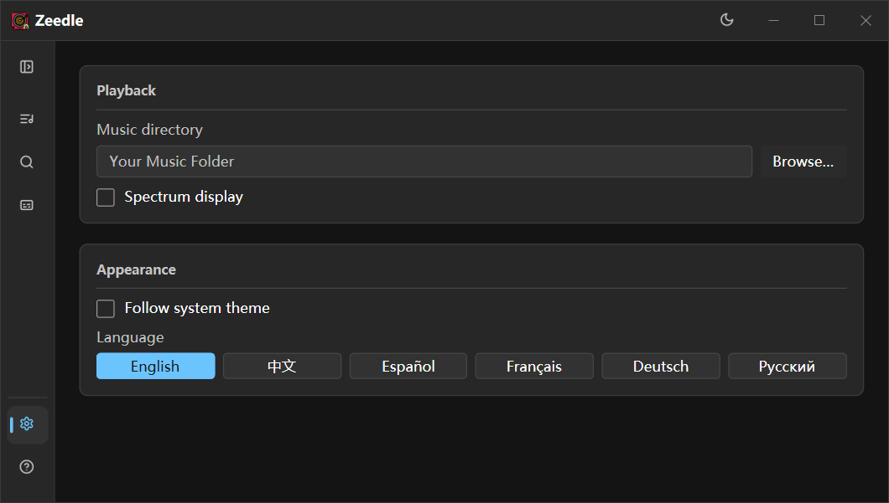
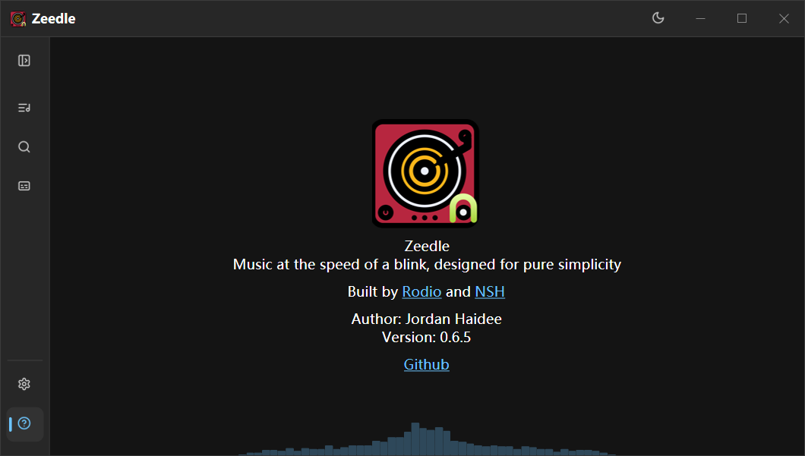
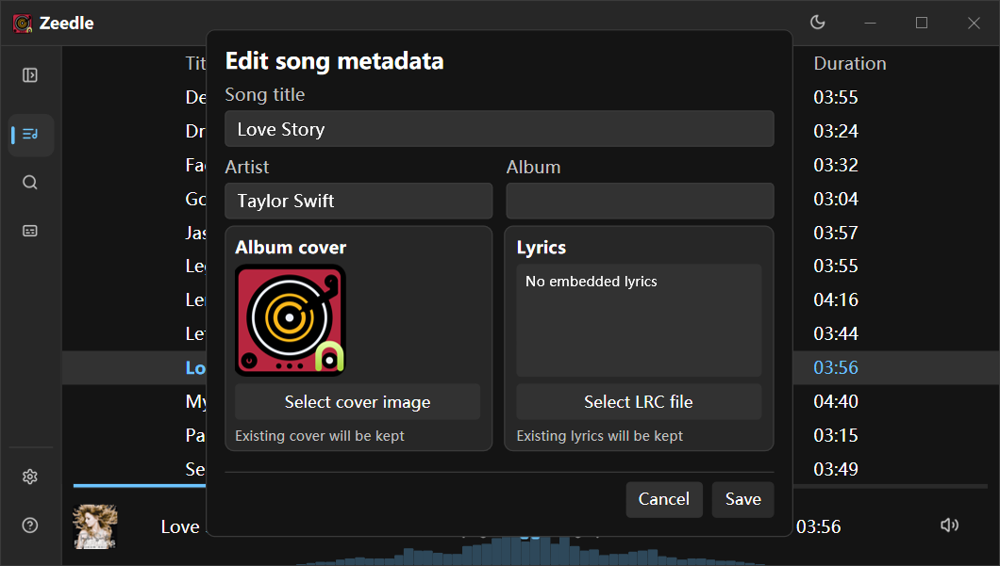

# Zeedle

Zeedle is a lightweight music player ported to Native Shell. It keeps the focused workflow of the original Zeedle while using an NSH desktop interface backed by Rust and Rodio. Portable builds target Windows x64, Linux x64 and Apple Silicon macOS.

## Highlights

- Browse a local music library and search by song or artist.
- Follow synchronized lyrics and jump to a line to seek playback.
- See a live spectrum while listening.
- Edit song metadata, album art and lyrics in place.
- Switch between ordered, repeat and random playback, with keyboard shortcuts for common actions.
- Use English, Chinese, Spanish, French, German or Russian with light and dark themes.

## Screenshots

Source: [Jordan-Haidee/zeedle-nsh](https://github.com/Jordan-Haidee/zeedle-nsh).
